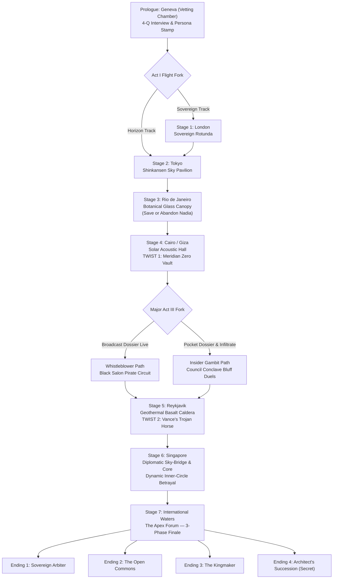
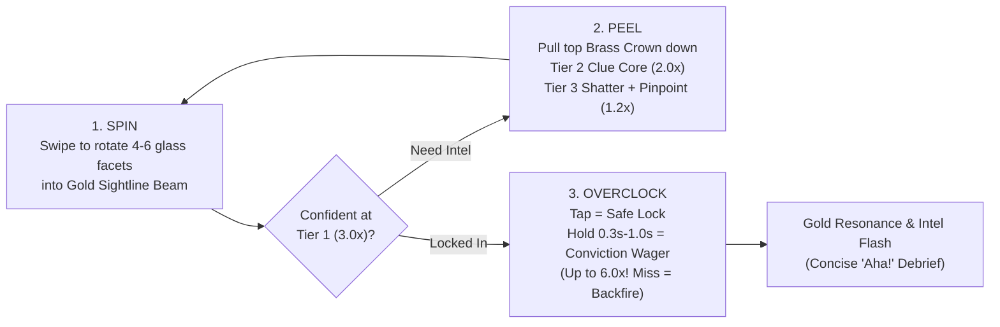
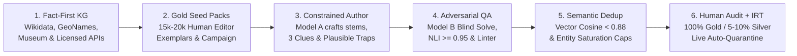

# WORLD'S SMARTEST — Executive Game Pitch Bible

> **Genre:** Prestige 3D Mobile Trivia Thriller & Interactive Narrative Adventure
> **Platforms:** iOS & Android (Portrait-First 9:16, Adaptive Tablet/Landscape)
> **Engine & Core Stack:** Unity 6 LTS (URP Forward+), Ink Narrative Engine, Wwise/FMOD, CoreHaptics / Android VibrationEffect
> **Target Audience:** Fans of prestige trivia (*Jeopardy!*, *NYT Games*), globe-trotting thrillers (*Knives Out*, *Hitman*, *Mission: Impossible*), and tactile 3D puzzle-box craft (*The Room*, *Monument Valley*)

---

## 1. Executive Pitch

**Logline:**
*When the world's leaders launch an unprecedented global contest to crown humanity's sharpest mind, you realize too late that the questions aren't just testing what you know—they're testing who you'll become when you hold the answers.*

**Why *World's Smartest* Breaks the Mobile Trivia Category:**
For a decade, mobile trivia has been trapped in flat 2D grids: four dull rectangles over a static background, stale recycled questions, zero narrative stakes, and pay-to-win lifelines. ***World's Smartest*** reinvents the genre around four interlocking AAA pillars:

1. **The Star Mechanic — *The Veritas Prism* (*"Spin. Peel. Overclock."*):** Trivia is no longer tapping buttons. Every question lives inside a weighted, luxury-watch-grade 3D construct floating on a live global stage. You physically **spin** frosted-glass facets into a volumetric sightline beam, **peel** open obsidian shutters to trade score multipliers for holographic clues, and **press-and-hold** to wager your confidence under crushing timer pressure.
2. **A Deep Branching Global Thriller:** Starting with a tense 3D one-on-one vetting interview in an Alpine vault, you travel across **7 iconic world venues**—forging alliances, spotting live 3D character tells, uncovering a vanished predecessor's conspiracy, and making choices that **directly rewrite the trivia rules, rival AI, venues, and endings**.
3. **AAA Mobile 3D Presentation (*Sovereign Modernism*):** Sculpted stylized-realism characters with 52-blendshape facial acting, gallery-grade architectural arenas with dual *Broadcast* and *Twist Fracture* lighting states, a 6-layer adaptive orchestral/regional score, and machined-luxury mobile haptics—locked at **60 fps** inside a **≤ 200 MB** initial store download.
4. **Industrial-Strength 1,000,000-Question Architecture (*THE FORGE*):** Engineered from Day 1 for **1,048,576 dense question IDs**, backed by a 6-stage fact-first & cross-vendor adversarial verification pipeline, an exact **125 KB Roaring Bitmap** zero-repeat tracker, **~155 bytes/question** Zstd offline packs, and server-authoritative anti-cheat for global competition.

---

## 2. The Story: *The Meridian* & *The Ledger*

### 2.1 Worldbuilding & Tone
The tone blends *Knives Out* (razor-sharp wit, charismatic rivals, puzzle-box revelations) with *Mission: Impossible* (jet-setting glamour, covert backroom deals) and the infectious joy of *The World's Fair*. Crucially, the surface is **aspirational, dazzling, and celebratory**—making the creeping geopolitical thriller hit twice as hard.

Under the **Geneva Charter of Human Stewardship**, world leaders unveil **THE MERIDIAN**: a televised global contest to find one unaffiliated human polymath—the **First Citizen Arbiter (*"World's Smartest"*)**. The winner claims a **\$100M legacy endowment**, a permanent seat before the World Council, and the sole human veto key over **THE LEDGER**—a unified planetary truth and crisis-forecasting archive built so no single superpower can secretly rig global treaties.

Three rival World Council blocs vie for influence behind the cameras:

| World Council Faction | Chair / Face | Philosophy | Trivia Domain Affinities |
| :--- | :--- | :--- | :--- |
| **The Sovereign Bloc** (*"The Iron Laurel"*) | Chancellor Ingrid Lindqvist | Order, Heritage, Protocol | History, Society & Law, Arts & Culture, Classical Science |
| **The Horizon Collective** (*"The Glass Spire"*) | Director Kenji Takahashi | Velocity, Optimization, Risk | Tech & Eng, Science, Logic & Cryptic, Economics |
| **The Agora Coalition** (*"The Open Commons"*) | Ambassador Amara Okafor | Transparency, Empathy, Culture | Geography, Pop & Media, Nature, Food & Craft |

---

### 2.2 The 3D Interview Prologue (*The Vetting Chamber* — Geneva)
No dry menus or popup tutorials. The game opens with an encrypted black-glass diplomatic summons—*"You solved what 400,000 couldn't"*—cutting straight into an intimate 85mm 3D close-up across a brushed-steel table from Chief Adjudicator **Julian Vance**, inside a brutalist slate monolith suspended over Alpine mist. Behind the one-way obsidian mirror, faint silhouettes shift.

The **4-Question Screening Assessment (~3 minutes)** seamlessly teaches every core gesture *while* profiling your mind and morals (and silently streaming your Stage 1 venue in the background):

1. **Q1 — Origin & Sightline Spin (`SIGHTLINE_LOCK`):** Vance asks why the scouting algorithm flagged an outsider. You pick your Origin (*Disgraced Academic*, *Street-Smart Polymath*, or *Pattern-Breaking Strategist*) as the **Veritas Prism** rises physically from the table. Spinning the facets teaches tactile selection while Vance's 52-blendshape FACS face reacts live to your composure.
2. **Q2 — Depth Peel & First Ethical Test:** As you weigh peeling the Prism's shutters for a clue, a shift behind the one-way glass causes rogue producer **Teo's** tablet to reflect a partial hint across the polished table. Real-time choice:
   - *Exploit the leaked glimpse* (`+Ambition`, `-Integrity`)
   - *Flag the security breach to Vance* (`+Council Favor`, `+Integrity`)
   - *Ignore it and solve cleanly* (`+Integrity`, hidden respect from both Vance & Teo)
3. **Q3 — Spotlight Overclock & Manifesto:** Overhead shutters slam; broadcast spots flare and the countdown tightens. You learn **Hold-to-Overclock** under pressure while answering Vance's core challenge: *"When you hold the sharpest mind on Earth, who does it answer to—the Council, the public, or only yourself?"*
4. **Q4 — Precision Calibration (`CALIBRATOR_DIAL`):** Vance unfolds the bespoke 3D **Meridian Brass Astrolabe**, letting you sculpt your own risk margin on a 3D Tolerance Cone.

**Payoff:** Vance stamps your 3D **Meridian Diplomatic Passport** with one of **4 Starting Cognitive Personas** (*The Maverick*, *The Diplomat*, *The Analyst*, or *The Prodigy*), initializes your 12-domain skill radar, and unlocks an immediate **Act I flight fork** on the interactive 3D World Globe: **London First (Sovereign Track)** or **Tokyo First (Horizon Track)**.

---

### 2.3 Act-by-Act Global Campaign, Twists & Four Endings

| Chapter | Location & 3D Venue | Bespoke Tier-3 Hero Artifact | Story Beat, Twist & Major Decision |
| :--- | :--- | :--- | :--- |
| **Prologue** | **Geneva (`CH`)** — *The Vetting Chamber* | Meridian Brass Astrolabe | Interactive 4-Q screening; ethical mirror leak; Persona stamp; Act I flight fork. |
| **Stage 1 (Act I)** | **London (`GB`)** — *The Sovereign Rotunda* | Locked Armillary Orrery | Debut against rival **Nadia Al-Mansoor**. Through glass floor panels you spot sealed drawers stamped *"TRIAL 00 — 2019."* **Choice:** Accept Chancellor Lindqvist's sealed briefing OR burn it unopened to unlock London's underground **Black Salon**. |
| **Stage 2 (Act I)** | **Tokyo (`JP`)** — *Shinkansen Sky Pavilion* | Folding Origami Prism | High-velocity round 70 floors above neon rain. Wildcard rival **Soren "Echo" Kael** locks answers in 0.8s via covert Horizon sub-vocal telemetry. **Choice:** Blackmail Soren for intel OR fire a **live signal jammer** mid-match. |
| **Stage 3 (Act II)** | **Rio (`BR`)** — *Botanical Glass Canopy* | Emerald Resonance Sphere | Twilight broadcast before 10,000 live fans. Someone sabotages Nadia's calibration pod before elimination. **Choice:** Sacrifice one of your own match Shields to save her (forging a loyal Ally) OR claim the #1 seed (creating a ruthless Nemesis). |
| **Stage 4 (Act II)** | **Cairo / Giza (`EG`)** — *Solar Acoustic Hall* | Meridian Zero Cipher Box | **MID-GAME TWIST — *MERIDIAN ZERO*:** The tracking brass solar oculus snaps shut in a staged blackout. Beneath the arena, a frantic live decryption sequence cracks the 2019 pilot dossier: its winner—**Tariq Al-Mansoor** (*Nadia's vanished brother!*)—found faction heads weaponizing The Ledger and was erased. Your own file reads **`PSYCHOMETRIC MATCH: 99.4%`**—Vance handpicked you because your mind mirrors Tariq's. **Major Fork:** *Broadcast live* (**Whistleblower Path**) OR *pocket the dossier* (**Insider Gambit Path**). |
| **Stage 5 (Act III)** | **Reykjavik (`IS`)** — *Geothermal Basalt Caldera* | Cryo-Core Relay | Divergent entry (closed Council Conclave vs. pirate-streamed Black Salon crash under the aurora dome). **ENDGAME TWIST — *THE TROJAN HORSE*:** You locate Tariq beneath the caldera—and discover **he has been working WITH Julian Vance all along.** Vance faked Tariq's disappearance to save his life and engineered the entire televised contest as a global chess trap: put an incorruptible polymath live before 2 billion witnesses holding both the public mandate and the decryption key so no superpower can bury the truth in the dark. |
| **Stage 6 (Act III)** | **Singapore (`SG`)** — *Diplomatic Sky-Bridge & Core* | Fractured Council Seal | Suspended above The Ledger's humming data monoliths as ultraviolet/crimson alarms trigger. **DYNAMIC PERSONAL BETRAYAL:** Based on your Ink relationship & alignment levers, an inner-circle figure flips—low-bond Nadia trades your seat for Tariq's amnesty, low-integrity Teo leaks your backstage deals to the crowd, or low-Council-Favor triggers an emergency charter framing you and crowning Soren interim Arbiter. |
| **Stage 7 (Act IV)** | **Int'l Waters (`GLOBAL`)** — *The Apex Forum* | Master Ledger Core | Monumental floating maritime citadel before 2 billion viewers: (1) *Gauntlet of the World* under faction interference, (2) *Rival Reckoning* against whoever your choices elevated, and (3) *The Arbiter's Gambit*—a 5-question sudden-death showdown against **Julian Vance himself**, unlocking The Ledger layer by layer live on air. |

**Four Distinct Endings (With Permanent Post-Game Unlocks):**
1. **The Sovereign Arbiter** *(High Council Favor + High Integrity):* Win cleanly, purge rogue faction chairs via treaty law, and reform The Ledger from the Arbiter's seat.
2. **The Open Commons** *(High Public Trust + Whistleblower):* Trigger Tariq & Teo's final lock override—open-sourcing The Ledger's suppressed climate and economic truths to 2 billion viewers live, forfeiting the \$100M crown to become a global folk hero.
3. **The Kingmaker** *(High Ambition + Ruthless Compromises):* Outplay Vance, cut a shadow pact with Lindqvist or Takahashi, and seize unilateral control—alone atop the glass spire as Vance quietly begins recruiting the next challenger to topple *you*.
4. **The Architect's Succession** *(Secret True Ending — High Integrity + Allied Nadia & Teo + 3 Hidden Vault Clues):* Refuse unilateral power and rewrite the Meridian Charter live on air to transform *"World's Smartest"* into a permanent rotating **Global Citizen Council**—directly canonizing the game's live Daily and Competitive modes.

---

### 2.4 Branching Choices That Directly Alter Gameplay
Every major decision writes to an **Ink Blackboard** (`axis_integrity`, `stat_public_trust`, `stat_council_favor`, and `bond_<npc>`) that dynamically modifies live trivia rules, opponent AI, and question queries—**zero flavor-only choices**:

| Story Choice | Immediate Gameplay & Prism Consequence | Downstream Ripple |
| :--- | :--- | :--- |
| **London:** Accept vs. Burn Lindqvist's Briefing | *Accept:* Grants **Diplomatic Redaction** (auto-shatters 1 high-plausibility decoy or free Tier-2 Peel on Q1). *Burn:* Grants **Clean Hands** (`+25%` unassisted Tier-1 bonus) + unlocks hidden London **Black Salon** match. | Accepting triggers a **Suspicion Audit**, flipping Nadia's Act II AI to aggressive *Tempo Steal*. |
| **Tokyo:** Blackmail Soren vs. Fire Live Jammer | *Blackmail:* Unlocks **Horizon Probability Lens** (hairline stress-fractures subtly mark weak distractors at Tier 1). *Jammer:* Fires a **Mid-Match Live Audible**—Fracture crimson lighting seals **Depth Peel** shut for *both* players! | Jammer pivots the Tokyo question query to `LATERAL_DEDUCTION` + `CRYPTIC`, neutralizing Soren's earpiece prep. |
| **Rio:** Sacrifice Shield to Save Nadia vs. Take #1 Seed | *Save:* You fight Rio's Boss Showdown down **1 Prism Shield** (immediate tactical sacrifice). *Leave:* Full Shields in Rio. | Allied Nadia unlocks **Co-Op Cross-Check** (free 1x/match Tier-2 cue); Nemesis Nadia queries your real **`θ_domain` skill vector** to deliberately counter-pick *your weakest trivia category*! |
| **Cairo:** Whistleblower Broadcast vs. Insider Gambit | *Whistleblower:* Strips VIP perks; unlocks **Black Salon** All-In Blitz + crowdsourced **People's Lens** live global answer heatmap. *Insider:* Grants **Council Override** domain vetoes + **Bluff Overclock** duels in Reykjavik. | Rewrites your Reykjavik venue entry, Singapore betrayer, and Finale opponent. |

---

### 2.5 Cast of 5 Recurring 3D Characters *(With Live Gameplay Tells)*
Each hero rig uses an ARKit-compatible **52-blendshape FACS face** and directional 3D audio cues so observant players read human behavior right alongside trivia facts:

- **Julian Vance (*Host & Chief Adjudicator — "The Maestro"*):** Midnight-indigo tuxedo, brass pocket astrolabe. *Stanley Tucci × Benoit Blanc.* **Tell:** Adjusts his left brass cufflink when withholding truth; rhythmic right-ear stylus tap when impressed.
- **Nadia Al-Mansoor (*Prodigy Rival — "The Polymath"*):** Egyptian-Swiss acoustic engineer; charcoal/ochre tailoring, gold geometric ear-cuff. **Tell:** Micro-blink and tiny corner smirk right before locking a lethal answer; jaw clench when rattled.
- **Mateo "Teo" Rojas (*Rogue Broadcast Producer — "The Fixer"*):** Argentine ex-investigative journalist turned Meridian tech; olive linen, dual wrist-displays, perpetual espresso. **Tell:** Rapid eye-check toward control-room cameras before left-ear binaural whispers.
- **Chancellor Ingrid Lindqvist (*Sovereign Chair — "The Kingmaker"*):** Former Nordic PM; ivory architectural coat, minimalist platinum spectacles. **Tell:** Slowly removes spectacles only before delivering a backroom deal or genuine threat.
- **Soren "Echo" Kael (*Wildcard Contender — "The Chaos Agent"*):** British-Korean former poker hustler; plum velvet bomber, amber smart-lenses, weighted coin rolling across knuckles. **Tell:** The coin freezes dead between his fingers whenever his Horizon earpiece feeds him a high-confidence hit.

---

## 3. The Star of the Game: *The Veritas Prism*

> [!IMPORTANT]
> **Design Philosophy:** Flat 4-button multiple choice reduces intelligence to a binary reflex—either you know it or you guess blindly. Real intelligence is **deduction under pressure, calibrated confidence, and proving how little information you need to solve the puzzle**.

Every question in *World's Smartest* lives inside **The Veritas Prism**—a tactile 3D obsidian, brushed-brass, and frosted-glass kinetic construct floating in the center **42% Spotlight Plane** of a portrait mobile screen, engineered for effortless **one-thumb play** while your 3D Host and Rival react live across the arena stage.

### 3.1 The Three Tactile Verbs: *Spin. Peel. Overclock.*

1. **SPIN — 3D Sightline Selection:** Four to six beveled frosted-glass **Answer Facets** orbit a weighted equatorial brass gimbal. Swiping horizontally spins the Prism with physical inertia and crisp 8ms watch-escapement CoreHaptics detents. Only the facet rotated into the front volumetric **Gold Sightline Beam** snaps into razor-sharp MSDF typography; flanking facets angle obliquely while rear facets rest in shadow.
2. **PEEL — 3-Tier Depth Deduction *(Replaces Stale 2D Lifelines)*:** Every question opens sealed at **Tier 1: Cold Instinct (`3.0x` Genius Multiplier)**. Unsure? Drag downward on the Prism's top **Brass Crown Ring** to physically crack open the 3D construct, trading multiplier for surgical deduction while the molten-gold **Chrono-Ring** ticks down:
   - **Tier 2 — *The Clue Core* (`3.0x → 2.0x`):** Obsidian shutters spiral open with a pneumatic hiss; a volumetric **SDF Holographic Core Glyph** blooms inside the hollow center above a concise **Lateral Clue**.
   - **Tier 3 — *The Blueprint Core* (`2.0x → 1.2x`):** A second pull expands the Prism into an exploded 3D blueprint! Half the false facets physically **shatter and drop off the gimbal** (leaving a tense 2-facet duel) as a **Pinpoint Clue** illuminates the core.
3. **OVERCLOCK — Hold-to-Lock Spatial Confidence Wager:**
   - **Short Tap (`0.2s`):** Safe Lock at your active Tier multiplier.
   - **Press & Hold (`0.3s → 1.0s`):** Brass clamping jaws compress inward, camera pushes tight, turbine/heartbeat haptics crescendo (`0.2 → 0.9`), and molten gold surges up the facet—multiplying payout up to **+100% (`6.0x` max on a Tier-1 Overclock)**. Release to slam the firing pin home (*THUNK!*).
   - **Risk & Bluff Counterplay:** Miss an Overclock and the facet violently **Backfires** (crimson radial fracture, shattering your Prism Shield or gifting your Rival a free Tier-2 peek). Second-guessing mid-charge? **Flick sideways to Cancel** and vent safely (also usable as a *Bluff Echo* feint in high-level duels!).

### 3.2 Five Physical Morphs on One Modular 3D Chassis
Driven purely by `QuestionRecord.archetype_3d`, the exact same 3D hardware seamlessly reconfigures between questions so **1,000,000 questions never feel repetitive**:

1. **`SIGHTLINE_LOCK` (~60%):** Rotating 4–6 facet Prism + 3-Tier Depth Peel + Hold-to-Overclock.
2. **`CODEX_DUAL_RING` (~15% — Synthesis & Pairing):** Prism splits horizontally into **2 counter-rotating brass rings** (Top = 3 Subjects, Bottom = 3 Targets + 1 Decoy). Spin both rings independently to lock 3 glowing vertical laser conduits, then slam the Crown.
3. **`CALIBRATOR_DIAL` (~15% — Precision Estimation):** Collapses into a **3D Brass Astrolabe Dial** for dates, distances, and numbers. Spin to aim the laser needle, and **drag vertically to pinch or widen the volumetric 3D Tolerance Cone**—wide safe margin (`±25 yrs = 1.0x`) vs. incandescent white-gold pinhole (`±1 yr = 3.5x` Bullseye!).
4. **`GAUNTLET_SHATTER` (~10% — Rapid Kinetic Surge):** Crystalline *Veritas Plates* drop every 3.5s. **Swipe Right (Verify/True)**, **Swipe Left (Debunk/False)**, or **Flick Up (*Challenge!*)** on subtle trick statements for `2.0x` harmonic shatter chains.
5. **`HERO_ARTIFACT_SYNTHESIS` (Bosses & Story Set-Pieces):** Bespoke Tier-3 sculptural 3D relics (e.g., *Locked Armillary Orrery*, *Meridian Zero Cipher Box*) where physically rotating the 3D object exposes engraved clues and mechanical latches driving 3-step chained finale questions.

### 3.3 Concrete 30-Second Play-by-Play *(Tokyo Semi-Final Rival Duel)*
- **00:00–00:03:** Neon rain streaks the *Shinkansen Sky Pavilion*. An aged-bronze **History** Veritas Prism materializes with a tuned koto harmonic; the 18s Chrono-Ring ignites (`3.0x`). Bottom card reads: *"Which 1815 diplomatic summit redrew Europe's borders after Napoleon's defeat—nicknamed 'The Dancing Congress'?"*
- **00:03–00:08:** Five facets orbit: *Paris, Utrecht, Westphalia, Vienna, Tilsit*. Right thumb flick-spins with crisp 8ms haptic clicks (*Paris → Utrecht → Westphalia*). Above the Prism, rival Nadia's eyes narrow on her FACS rig as her cobalt lock-beam steadies—pressure spikes.
- **00:08–00:13 (The "Aha!" Peel):** You drag the top Brass Crown downward (`3.0x → 2.0x`). Shutters hiss open; a golden 3D wireframe **double-eagle & chandelier glyph** blooms above the Lateral Clue: *"Hosted by Chancellor Metternich in the Habsburg imperial capital."* Instant epiphany: **VIENNA!**
- **00:13–00:17 (Snap & Overclock):** One firm swipe right—magnetic *CLACK!* **VIENNA** locks into the Gold Sightline Beam. Trailing by 400 points, you **press and hold** for `0.8s`: brass jaws clamp tight, heartbeat haptics roar, gold surges to **`3.7x OVERCLOCK`**. Release—*THUNK!*
- **00:17–00:25 (Payoff):** Half-second breath of total silence... **GOLD RESONANCE!** The four false facets shatter into shimmering obsidian dust; Tokyo strings swell (`L5_StreakEuphoria`), Nadia visibly winces across the stage, and a crisp 1-line **Intel Flash** confirms the story behind Metternich's galas.
- **00:25–00:30:** The solved Prism condenses into a gold shard tipping the Arena Momentum Beam as the hardware smoothly splits into a **Codex Dual-Ring** for Question 4.

### 3.4 Encounter Escalation Across the Campaign
- **Regional Qualifiers:** 5–7 mixed Prism questions (~40% host-country cultural/historical flavor, ~60% global mastery).
- **Rival Head-to-Head Duels:** Read live physical tells—a gold steam vent on a Rival's Prism means they peeled Tier 2; a crimson surge means they're Overclocking. Late-game rivals deploy tactical modifiers (*Tempo Steal*, *Frost Veil*, *Bluff Echo*).
- **3-Phase Country Boss Showdowns:** (1) *Shield Break* (`GAUNTLET_SHATTER` blitz) → (2) *Hero Artifact Synthesis* (3-step chained Tier-3 Relic) → (3) *Sovereign Sudden Death* (one giant shared central Prism where whoever holds Overclock longer claims first strike—and Backfire is instant defeat).

---

## 4. Full Game Mode Suite (5 Modes, 1 Unified Core)

| Game Mode | Lore Identity | Core Loop & Unique Hook | Authority & Session Length |
| :--- | :--- | :--- | :--- |
| **Campaign** | ***The Meridian Circuit*** | Prologue Interview → 7 Global Venues → Branching Choices → Boss Showdowns → 4 Endings + *New Circuit+* branch replay. | `GOLD_HUMAN` pool; authored sawtooth pacing; **offline-capable** (prefetched). **4–6 min/match**. |
| **Daily** | ***The Global Feed*** | One synchronized 00:00 UTC **7-Prism World Broadcast** hosted by Julian Vance (spanning all 4 morphs + Calibrator Bullseye tiebreaker + current-events pulse). Outputs **Global Percentile** & spoiler-free Wordle-style Peel/Overclock share grid. | **Zero adaptive scaling** (100% uniform seed); **Server-authoritative JIT**. **2.5–3.5 min**. |
| **Quick / Classic** | ***The Briefing Room*** | Frictionless 5-question calibration runs hosted by Nadia. Play Global Mix or target any of **12 Domains / 90 Categories / 700 Subcategories** to climb Category Elo & Passport mastery crests. | Flow-state adaptive (`65–75%` target); **100% offline-ready**. **2 min**. |
| **Endless** | ***The Archive Descent*** | Push-your-luck descent through *The Ledger's* subterranean tiers (*Public Strata → Diplomatic Vaults → Meridian Zero Core*) with **3 Prism Shields**. Every 5 Qs hits an **Extraction Airlock**—bank your haul or descend into harsher modifiers & redacted lore logs. 3-streak Overclock repairs 1 Shield; Backfire shatters 2. | Monotonic `irt_b` climb to polymath tier (`+3.2`). Offline practice / Online JIT leaderboard. **5–15 min (checkpoint-resumable)**. |
| **Competitive & Social** | ***World Council Trials*** & ***The Black Salon*** | • **3D Async Ghost Duels:** Race real players' recorded **3D Kinetic Ghosts** (~300 B/Q capturing exact spin, Peel timing, and Overclock glow)—zero lag, feels live. • **Faction Leagues:** Pledge to *Sovereign*, *Horizon*, or *Agora* + National Cups. • **Weekend Black Salon:** Teo's 16-player live knockouts with rotating underground rules (*Analog Static*, *All-In Blitz*). | Elo-bracketed, **Zero Pay-to-Win**, Server JIT + Anti-Cheat. **3–5 min**. |

---

## 5. Top-End Mobile 3D Graphics, Audio & Haptics (*Sovereign Modernism*)

### 5.1 Visual Pillar & Ergonomic Framing
- **Signature Look — *Sovereign Modernism*:** *Arcane*-grade sculpted character appeal meets *Hitman* architectural prestige meets *Swiss Haute Horlogerie* hardware craft. Stylized hyper-tactile realism avoids photoreal uncanny valley and thermal throttling while reading unmistakably AAA on 6-inch daylight screens.
- **Portrait-First (9:16) Three-Zone Hierarchy:**
  - **Top 28% (Stage & Story Plane):** 3D Host/Rival framing, venue vista, Rival Prism tells, broadcast chyron.
  - **Middle 42% (Spotlight Plane):** Unobstructed interactive **Veritas Prism** with shallow DOF separating background architecture.
  - **Bottom 30% (Ergonomic Thumb Arc):** High-contrast Prompt Card (`≤ 140 chars`), Peel tab, and Hold-to-Overclock bar inside natural one-thumb reach. *(Tablets/Foldables widen seamlessly into panoramic landscape.)*

### 5.2 Scaling AAA 3D Visuals Across 1,000,000 Questions (3-Tier Asset Pyramid)
We never attempt 1,000,000 bespoke 3D models. Instead, visual luxury scales deterministically via metadata:
- **Tier 1 — Core Modular Chassis (100% of DB):** One sculpted `18k–24k tri` Veritas Prism rig capable of all 5 physical morphs, rendered with crisp world-space MSDF typography (`≤ 28 chars/facet`).
- **Tier 2 — 12 Procedural Domain Shader Kits + 500 SDF Holographic Core Glyphs (~2.5 MB total!):** Each `L0 Domain` automatically shifts the Prism's PBR material family (*History* = aged bronze patina; *Science* = iridescent cobalt + orbital particles; *Arts* = Carrara marble + kintsugi gold; *Tech* = smoked polycarbonate + etched PCB gold; *Myth* = lapis lazuli + astral gold-leaf; *Logic* = dichroic refraction), while each country venue swaps plinth architecture, shatter particles, and reverb acoustics.
- **Tier 3 — 40–60 Bespoke Hero 3D Artifacts:** Handcrafted trailer-grade sculptural relics for the 8 Campaign set-pieces plus rotating Featured Daily Curiosities, proudly displayed afterward in your interactive **3D Intel Observatory** trophy study.

### 5.3 Mobile AAA Rendering & Streaming Budget
- **Frame Rate:** Locked **60 fps** on mid-to-high tier (iPhone 13+ / Snapdragon 8 Gen 1+); smooth **30 fps + Dynamic Resolution Scaling** on 4 GB entry devices.
- **Rendering Recipe:** `≤ 85–110` draw calls/frame (SRP Batcher, GPU-instanced silhouettes), `180k–260k` visible tris, **Hybrid Baked Global Illumination** (high-res lightmaps + reflection probes) + 1 dynamic Hero shadow caster + Fresnel light-shaft meshes (zero heavy raymarched fog).
- **Harmonized Storage Budget:** **≤ 200 MB initial App Store / Play Store download** (Engine, Prism Chassis, 12 Domain Shaders, 500 SDF Glyphs, Core Cast, Geneva Vetting Chamber, Briefing Studio, Core Audio, 25k starter questions). Your chosen Stage 1 venue (**London** or **Tokyo**, **45–85 MB Addressables bundle**) streams silently in the background *during the 3-minute Interactive Interview Prologue*—zero wait, with LRU eviction capping total device footprint **< 1.2 GB**.

### 5.4 Adaptive Audio, Haptics & Sane VO Strategy
- **6-Layer Vertical-Remix Score (Wwise/FMOD):** Modern chamber cinema blended with **regional soloists** per venue (London cello, Tokyo koto/shakuhachi, Rio nylon guitar/berimbau, Cairo oud/riq, Reykjavik glass marimba, Singapore guzheng/modular synth). Dynamic stems transition smoothly across `L1_VenueBed` → `L2_InterviewTension` → `L3_DeductionPulse` → `L4_CountdownEscalation` → `L5_StreakEuphoria` → `L6_TwistFracture`, with key-locked musical stingers.
- **Machined-Luxury Haptics (*CoreHaptics AHAP / Android VibrationEffect*):** Watch-escapement micro-clicks on Spin, magnetic glass-on-brass *clack* on Sightline snap, pneumatic shimmer on Peel, rising turbine/heartbeat ramp (`0.2 → 0.9`) into a heavy vault-bolt `PRIMITIVE_THUD` on Overclock lock, and venue-matched Convolution Reverb bloom on reveal.
- **Tiered VO Architecture:** **~3,500 performance-captured Tier-1 hero lines** voice the Interview, story cutscenes, twists, and Boss intros (localized across core launch languages). **We never voice 1M questions**—instead, **~300 modular Tier-2 reaction cues per character** (*"Bold Overclock!"*, sharp inhale, knowing chuckle) fuse with FACS acting and Foley so every live round feels directed.

---

## 6. Implementing 1,000,000 Questions & Tech Architecture

### 6.1 Deterministic Taxonomy & Compact `QuestionRecord` Schema
Every question carries a dense monotonic 24-bit ID (`uint32 qid: 1..1,048,575`), 4-tier taxonomy (**12 L0 Domains → ~90 L1 Categories → ~700 L2 Subcategories → ~20,000 Wikidata-anchored L3 Micro-Topic Entity Clusters**), orthogonal **ISO-3166 regional weights**, a **32-bit `narrative_bitmask`** (16 launch story tags + 16 reserved for LiveOps), **2PL/GRM IRT psychometric parameters** (`irt_b`, `irt_a`, `irt_c`), **freshness TTL** (`EVERGREEN`, `SLOW_DRIFT`, `CURRENT_EVENTS` with hard `expires_at_epoch`), **3 progressive deductive `ClueTier`s**, plausibility-scored distractors, a concise `why_explanation` (`≤ 180 chars`), and a typed `mechanic_ext_blob` driving all 5 Veritas Prism morphs.

### 6.2 *THE FORGE* — 6-Stage Hybrid Pipeline (Zero Hallucination Slop)

> [!TIP]
> **20-Year Veteran Reality Check:** Writing 1,000,000 questions purely by hand costs \$5M–\$10M+ and takes 5 years. Blind LLM generation produces 8–15% hallucinations and bland duplicates that kill a prestige brand. **THE FORGE** separates *fact grounding* from *prose authoring* and *cross-vendor adversarial verification*.

1. **Fact-First Knowledge Graph Ingestion:** Extracts verifiable `(Subject QID, Predicate, Object, Temporal Validity, Source Revision)` tuples from Wikidata, OpenAlex, GeoNames, museum open-access APIs (Met/Smithsonian), and licensed feeds—and natively auto-generates numeric `CALIBRATOR_DIAL` items and sibling-entity `CODEX_DUAL_RING` pairings. Zero ungrounded invention.
2. **Expert Gold Seed Packs:** Jeopardy!/quiz-bowl-caliber editors hand-write **15,000–20,000 Gold Seed Questions** covering 100% of Campaign, Interview, Boss Showdowns, and style exemplars.
3. **Constrained Authoring (Model Family A):** Drafts crisp `≤ 140`-char stems, `≤ 28`-char glass-facet answers, 3 escalating `ClueTier`s, and plausible same-ontology distractors strictly bound to cited source spans.
4. **Cross-Vendor Adversarial Verification (Model Family B + Linter):** Runs a **Blind Solve Test** (catches ambiguity/multi-valid answers), **Citation Entailment (`≥ 0.95`)** verifying no distractor is accidentally true, temporal expiry tagging, and deterministic MSDF char-budget/clue-leak linting.
5. **Semantic Deduplication & Entity Quotas:** Dense embeddings reject cosine similarity `≥ 0.88` inside any entity cluster and cap per-entity counts (preventing 500 Eiffel Tower repeats while ensuring deep coverage across 190+ countries).
6. **Tiered Human Sign-Off & Self-Healing Shadow Calibration:** 100% human sign-off on Campaign/Boss/Daily (**Gold Tier**); stratified 5–10% batch audits on **Silver Tier** (`> 0.5%` error bounces the entire batch). New Silver items calibrate in low-stakes Classic play (`N = 200` responses); nightly IRT jobs auto-quarantine any question with low discrimination (`irt_a < 0.25`) or `> 0.4%` player ambiguity flags.

**Honest Scaling Roadmap (Architected for 1M from Day 1):**
- **Soft Launch (M0):** **50,000–75,000** verified questions *(> 2.5 years of non-stop play at 50 Qs/day)*.
- **Global Launch (M3):** **120,000–150,000** fully IRT-calibrated questions.
- **Year 1 LiveOps:** **350,000–500,000** questions (~25k–30k/mo via seasonal Country Packs & live current-events rotation).
- **Year 2+ Full Scale:** **1,000,000+ verified questions** with zero schema migration (and localized regional Forge pipelines rather than blind machine translation of English idioms).

### 6.3 Anti-Repetition, Adaptive Flow, Offline Sharding & Anti-Cheat
- **Exact Zero-Repeat Engine (Roaring Bitmaps > Bloom Filters):** Because `qid` is dense `1..1,048,575`, an **exact** 1M-question bitset is at most **125 KB raw** (~10 KB for a 5k-question player via Roaring Bitmap)—zero Bloom-filter false positives, `< 0.2 ms` on-device `ANDNOT` filtering, paired with `micro_topic_id` (30-Q) and `L2` (5-Q) cooldown ring buffers so players never suffer "soft repeats."
- **Graded Response Model (GRM) Adaptive Director:** Tracks global `θ_global` and a **12-Domain Skill Vector `θ_domain[0..11]`** based on epistemic mastery (Tier-1 Cold Instinct > Tier-2 Peel > Tier-3 Peel; Calibrator accuracy), keeping Overclock strictly a risk/score wager so Elo can't be gamed.
- **Offline + Online Delivery Math:** Runtime `QuestionRecord` (~550 B raw) compresses via **Zstd + trained trivia dictionary (~3.5x)** to **~155 bytes/question**. **50,000 offline questions take just ~13 MB total (including SQLite indices)!** Catalog ships in immutable ~350 KB CDN shards prefetched over Wi-Fi with `< 50 KB` tombstone deltas.
- **Tamper-Proof Competitive Split & Anti-Cheat:** Prefetched Campaign/Classic/Practice Endless work seamlessly on airplanes and subways. **Daily & Ranked questions NEVER touch local storage**—streamed **Just-In-Time (JIT)** over TLS/gRPC with server clocks. Combined with continuous Chrono-Ring speed decay (making 6–9s second-device Google/AI lookups uncompetitive), OS focus-loss/screen-capture hooks, Apple App Attest / Play Integrity, and statistical **Touch-Kinematics + IRT Person-Fit** anomaly detection routing bots into **Silent Shadow-Bucket Leaderboards**, competitive integrity stays rock solid.

### 6.4 Recommended Client & Backend Stack
- **Client:** **Unity 6 LTS + URP Forward+ + Addressables** (beats UE5 Mobile on binary size/thermals and Godot 4 on AAA mobile LiveOps, Wwise, CoreHaptics, and profiling maturity) + **Ink** compiled narrative state graphs wired cleanly to the trivia selector via a bidirectional `NarrativeTriviaBridge`.
- **Cloud:** Cloudflare/CloudFront Edge CDN → Stateless **Go / .NET 8** microservices on Kubernetes → **PostgreSQL** (profiles, Ink saves, Content Master) + **Redis Cluster** (leaderboards, global answer heatmaps, JIT nonces) + **ClickHouse/BigQuery** (nightly IRT calibration & quarantine).

---

## 7. Meta-Progression, Ethical Monetization & Production Roadmap

### 7.1 Long-Term Retention & Ethical Monetization

> [!CAUTION]
> **Sacred Studio Guardrail — ZERO PAY-TO-WIN:** Players can **never** buy extra clues, extra time, Prism Shields, or stat perks in Daily, Ranked, or Official Endless modes. *World's Smartest* lives or dies on intellectual legitimacy.

- **Meta-Progression:** **Meridian Diplomatic Passport** (visas, 12-Domain Mastery Radar, historical Global Feed percentiles), **3D Intel Observatory** (interactive trophy study displaying every unlocked Hero Relic and bookmarked *Intel Flash*), and **Prism Atelier** (cosmetic materials, shatter VFX/Foley, diplomatic attire).
- **Player-Friendly F2P / Premium-Hybrid Model:**
  1. **Generous Free Core:** Full Prologue + Act I Campaign, unlimited Daily *Global Feed*, unlimited *Briefing Room* drills (no punishing energy wall!), *Archive Descent*, and Ranked Ghost Duels.
  2. **World Circuit Pass / Optional One-Time "Full Campaign Unlock":** Unlocks full multi-act Campaign access (also earnable gradually via free Prestige Milestones) + seasonal cosmetic Prism materials (*Damascus Steel, Kyoto Gold, Emerald Crystal*) & Observatory themes.
  3. **Optional Collector Specialty Decks:** Deep-dive niche packs (*Criterion World Cinema*, *Quantum Frontiers*) for Quick/Private Party modes—never gating Ranked fairness.
  4. **Opt-In Rewarded Ads Only:** Zero forced interstitials; optional ad views for vanity shards or an unranked offline practice retry.

### 7.2 High-Level Studio Production Roadmap (18–22 Months to Global Launch)

| Phase | Duration | Key Milestone & Exit Gate |
| :--- | :--- | :--- |
| **Phase 1: Playable Prototype** | Months 1–3 | Greybox **Veritas Prism** (*Spin, Peel, Overclock*, all 4 core morphs) in Unity 6 on mid-tier iOS/Android; test tactile fun, 1-thumb ergonomics, and CoreHaptics with 500 hand-written test questions. |
| **Phase 2: Vertical Slice** | Months 4–7 | Shippable-quality **Geneva Vetting Chamber Interview** + **Stage 1 London (*Sovereign Rotunda*)** + Julian Vance & Nadia FACS rigs + adaptive audio + **THE FORGE v1** pipeline (first 10k verified questions) + Ink `NarrativeTriviaBridge`. |
| **Phase 3: Full Production & Soft Launch** | Months 8–15 | All 7 global venues, 8 Tier-3 Hero Relics, 4 endings, all 5 modes, **50k–75k verified questions**, Addressables streaming (`≤ 200 MB`), anti-cheat JIT backend. Soft launch in 3–4 test territories (e.g., CA, AU, NL, PH) to tune D1/D7/D30 retention and IRT calibration. |
| **Phase 4: Global Launch & LiveOps** | Months 16–22+ | **120k–150k IRT-calibrated questions**, Tier-1 global dubs/localization, Season 1 *World Council Trials* & *Black Salon* weekend tourneys, scaling via monthly Country Packs & *THE FORGE* toward **1,000,000+ questions**. |
