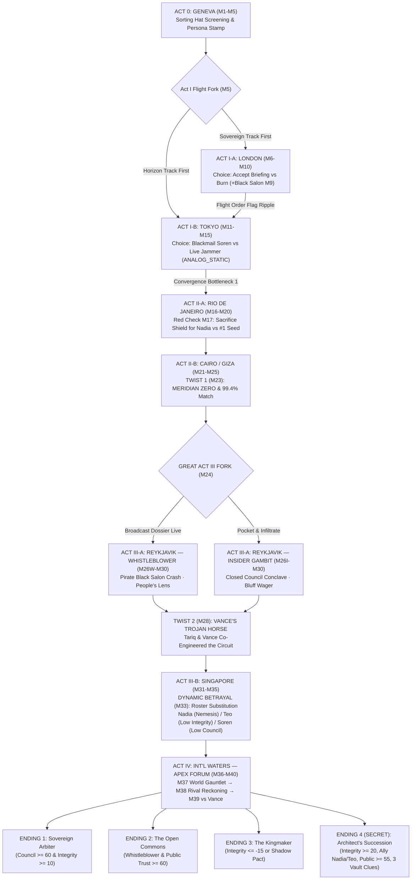

# Research Blueprint 03: 20+ Hour Branching Narrative Architecture & Anti-Repetition Systems
**Project:** *World's Smartest* (Godot 4.7.2 — Android Portrait 9:16 + Web HTML5)
**Author:** Researcher #3 (`@research-story-twists` — Branching Narrative & Anti-Repetition Systems)
**Consumers:** `@campaign-20hr-writer`, `@godot-aaa-director`, `@qa-art-critic`, `@coordinator`
**Canonical Lock:** Aligns 100% with `docs/PITCH_BIBLE.md`, `src/story/StoryState.ts`, `godot/data/campaign_20hr.json`, and `@voice-audio-director`'s 20+ neural `.mp3` clips.

> [!IMPORTANT]
> **Canon Cast Lock (Fixing Legacy Prototype Drift):** Legacy `godot/scripts/MainArena.gd` contained placeholder names (*"Nadia Okafor"*, *"Soren Kessler"*, *"Teo Morales"*). All Godot 4.7.2 scripts, `campaign_20hr.json`, voice tags, and HUD banners MUST strictly use the canonical Pitch Bible cast:
> - **Julian Vance** (*Host & Chief Adjudicator — "The Maestro"*)
> - **Nadia Al-Mansoor** (*Prodigy Rival — "The Polymath"*, sister of Tariq Al-Mansoor)
> - **Soren "Echo" Kael** (*Wildcard Contender — "The Chaos Agent"*)
> - **Mateo "Teo" Rojas** (*Rogue Broadcast Producer — "The Fixer"*)
> - **Chancellor Ingrid Lindqvist** (*Sovereign Bloc Chair — "The Kingmaker"*)
> - **Tariq Al-Mansoor** (*Trial 00 Winner — "Meridian Zero"*)

---

## 1. Comparative Narrative Architecture Audit (7 Masterworks → Studio Transplants)

A 20+ hour trivia thriller fails in one of two predictable ways: **(a) Combinatorial Explosion** (a naive binary choice tree across 40 missions demands $2^{40}$ branches — impossible to write or test), or **(b) The Telltale "Illusion of Choice" Collapse** (a state-amnesiac diamond funnel where *"[Character] will remember that"* changes one throwaway line before snapping back onto an identical railroad).

Our research across seven landmark narrative works and interactive-fiction theory (Sam Kabo Ashwell's *Standard Patterns in Choice-Based Games*, Emily Short's *State-Tracking & Quality-Based Narratives*, Jon Ingold's GDC talks, Greg Kasavin's GDC 2021 *Hades* post-mortem, Shu Takumi's GCC '18 mystery lectures, and Rian Johnson's *Knives Out* screenplay craft) defines the exact mechanisms we transplant directly into Godot 4.7.2:

| Reference Work | Proven Core Mechanism | Empirical / Design Evidence | Direct Transplant into *World's Smartest* |
| :--- | :--- | :--- | :--- |
| ***80 Days*** *(inkle / Jon Ingold & Meg Jayanth)* | **Quality-Based Narrative (QBN) & Storylets** over rigid trees | ~750,000 words across 150 cities; a single run sees ~2% of content. Modular storylets fire via state guards (money, time, luggage, relationships) on a 3D globe without exponential hand-wired trees. | **Globe Route Order (`GB ↔ JP`) + State-Gated Storylets:** Instead of writing 16 versions of every city, attach guard-predicate storylets (`bond_nadia == ALLIED`, `flag_london_briefing == BURNED`, `black_salon_unlocked == true`) that inject covert rooms, bonus encounters, and bespoke dialogue lines at each hub. |
| ***Disco Elysium*** *(ZA/UM / Robert Kurvitz & Justin Keenan)* | **Textural Micro-Reactivity, Passive Skill Interrupts & Red/White Checks** | Passive checks (`6 + skill` threshold) let internal skills interrupt dialogue seamlessly without halting flow. **Red Checks** lock permanently on failure; **White Checks** unlock again when state changes. Backward-looking micro-flags make choices feel remembered hours later. | **Domain-Elo Passive Interrupts + Red/White Story Locks:** When a player's `TriviaDatabase` rating in a domain exceeds a threshold (e.g., `HISTORY >= 1300`), an italicized **Analyst Insight** automatically catches a forged date or motive in dialogue! Mid-match ethical crises (`MIRROR_LEAK_ETHICS`, Rio Shield sacrifice) are permanent **Red Checks**; underground Black Salons & Relic clues act as **White Checks** re-openable via Observatory inspection or *New Circuit+*. |
| ***Detroit: Become Human*** *(Quantic Dream / David Cage)* | **Wide Local Branching + Hard Bottlenecks + Roster Substitution + Transparent Flowchart** | 32 chapters / ~2,000-page script prove that players forgive shared macro-locations when (1) *who* stands in the room changes (roster substitution/permadeath) and (2) an explicit post-chapter **Flowchart UI** shows greyed-out untaken branches, turning structural limits into completionist fuel. | **Dynamic Roster Substitution + Meridian Conspiracy Flowchart:** Every player reaches Singapore (M33) and Apex Forum (M38), but *who betrays you* (`Nadia` vs. `Teo` vs. `Soren`) and *who faces you in the semifinal* is dynamically substituted by state. Unlocking the **Conspiracy Flowchart** after Act I visually displays locked branches (Camden Black Salon, Whistleblower vs. Insider, 4 Endings), driving *New Circuit+* replays. |
| ***Ace Attorney* & *Apollo Justice*** *(Capcom / Shu Takumi)* | **The Takumi Loop + Physical "Perceive" Tells + Darkest-Hour Cascade** | Every case runs `Overarching Mystery → Suspect Assertion → Contradiction → New Development → Turnabout`. *Apollo Justice*'s **Perceive** turns involuntary bodily tics into gameplay weapons: *words lie, bodies confess.* | **5-Mission Country Takumi Loop + Exploit-Grade Character Tells:** Every city escalates from polished public facade to mid-arc contradiction to explosive Boss breakdown. Every character has a signature **Observable Tell** (Vance's cufflink, Soren's frozen coin, Nadia's micro-blink) that players read in dialogue AND actively exploit during `BLUFF_WAGER` / `WHISPERED_INSIDER` trivia rounds. |
| ***Persona 5*** *(Atlus)* | **Sawtooth Tension Pacing + Transactional Confidants** | Alternates high-adrenaline Palace infiltration with low-stress social/investigative beats so 100-hour pacing never flatlines. Confidant bonds are both emotional arcs *and* combat perks — narrative empathy produces direct tactical power. | **5-Slot Country Rhythm + Bond-to-Perk Loop:** Each city alternates Prestige Broadcast → Backroom Investigation → Rival Mind-Game → Fracture Crisis → 3-Phase Boss. Raising `bond_nadia` or `bond_teo` to `ALLIED` directly unlocks match perks (`COOP_CROSSCHECK`, `PEOPLES_LENS`); burning them to `NEMESIS` triggers hostile match mutators (`GRUDGE_WEAKEST_DOMAIN`). |
| ***Hades*** *(Supergiant / Greg Kasavin)* | **Priority-Prerequisite Dialogue Queue + Failure Advances Story + Behavioral Mutators** | 21,000+ voiced lines sorted by priority tiers and prerequisite flags with "spent" buckets so lines never repeat. Crucially, *dying unlocks new narrative beats*. The **Pact of Punishment** changes player *behavior*, not HP sponges. | **Priority Bark Triage + *Redemption Gauntlet* + Charter Heat:** Post-match reactions pull from a priority queue (`P0 Twist > P1 First Loss/Backfire > P2 Bond Shift > P3 Domain Callout > P4 Ambient`, marked `spent`). Losing a mission never loops the same cutscene — it triggers unique rival/Vance commentary and optional `REDEMPTION_GAUNTLET` recovery. |
| ***Knives Out*** *(Rian Johnson)* | **Mid-Stream Genre-Shift Inversion + Fair-Play Clue Planting + Thematic Payoff** | Shifts genre mid-movie: *Act I Whodunit → Act II Hitchcock Cover-Up Thriller → Act III Whodunit Payoff*. Every twist clue (swapped mugs, blood drop, quiet dogs) is shown cleanly on screen beforehand, hidden inside character comedy/pressure. | **Genre-Flip at Mission 23 + Fair-Play Clue Ledger:** Acts 0–II play as a glamorous prestige quiz championship; M23 Cairo (*Meridian Zero*) flips Act III into an espionage survival thriller; M28 Reykjavik (*Vance's Trojan Horse*) recontextualizes 8 fair-play clues visibly planted in M1–M22. |

---

## 2. The Exact 20+ Hour Narrative Architecture: *Branch-and-Bottleneck + Persistent-State-Ripple*

### 2.1 Why This Topology Solves 20+ Hours Without Bloat or Fake Choices
Instead of Ashwell's unbuildable **Time Cave** (exponential branching) or a hollow **Gauntlet** (fake cosmetic choices), *World's Smartest* combines **3 proven Ashwell patterns**:
1. **Sorting Hat Prologue (Act 0, M1–M5):** Rapidly profiles the player's `origin` (`ACADEMIC` / `POLYMATH` / `STRATEGIST`), `manifesto` (`COUNCIL` / `PUBLIC` / `SELF`), ethical reflex (`prologue_leak`), and gameplay style (Peel vs. Overclock) to stamp 1 of 4 **Cognitive Personas** (`MAVERICK`, `DIPLOMAT`, `ANALYST`, `PRODIGY`) and fork the Act I flight order (`GB` vs. `JP`).
2. **Branch-and-Bottleneck with Persistent-State-Ripple (Acts I–III, M6–M35):** All 8 global venues remain shared high-production 3D architectural spaces, *but* every major decision writes to a 4-layer **Persistent Blackboard** that physically alters lighting states, match mutators, unlocked underground missions, rival AI behavior, question selection queries, and who sits in the betrayer's chair.
3. **Loop-and-Grow *New Circuit+* (Post-Act IV):** Completing any of the 4 endings unlocks the transparent **Meridian Conspiracy Flowchart**, **Tariq's Redacted Margin Notes** (*NieR: Automata*-style dramatic irony on replay), and **Charter Heat** (*Hades*-style opt-in mutator stacking), while the 128 KB `PackedByteArray` seen-question bitset persists so **replay runs pull fresh questions from the 3,000+ catalog with zero trivia repeats**.

### 2.2 Macro Campaign Topology (8 Global Hubs · 40 Missions · 4 Endings)



### 2.3 The 4-Layer Persistent-State Blackboard (Zero State Amnesia)
`@campaign-20hr-writer` and `@godot-aaa-director` MUST maintain this exact state schema across all 40 missions (serialized to `user://meridian_campaign_save.json` in Godot 4.7.2, mirroring `src/story/StoryState.ts`):

1. **Layer A — Macro Alignment Axes (Continuous Telemetry):**
   - `axis_integrity` (`-100` Ruthless Ambition .. `+100` Uncompromising Integrity; starts `0`)
   - `public_trust` (`0..100`; starts `50`) — governs broadcast crowd sentiment, `PEOPLES_LENS` accuracy, and Ending II/IV eligibility
   - `council_favor` (`0..100`; starts `50`) — governs diplomatic perks, Conclave entry, Article IX framing risk, and Ending I eligibility
2. **Layer B — 4-Step NPC Bond Lattice (`NEMESIS | RIVAL | NEUTRAL | ALLIED`):**
   - Tracked for `nadia` (starts `RIVAL`), `teo` (starts `NEUTRAL`), `lindqvist` (starts `NEUTRAL`), `soren` (starts `RIVAL`), plus post-M28 `tariq` (`NEUTRAL` → `ALLIED` / `RIVAL`).
   - **Hard Rule:** Every bond tier transition MUST surface an immediate diegetic UI toast + change at least one active gameplay rule or dialogue path!
3. **Layer C — Discrete World & Conspiracy Flags (`flags: Dictionary`):**
   - `origin` (`ACADEMIC | POLYMATH | STRATEGIST`), `persona` (`MAVERICK | DIPLOMAT | ANALYST | PRODIGY`)
   - `first_flight` (`GB | JP`) — shifts rival introductions (e.g., if you beat Tokyo first, Nadia in London remarks on how you humiliated Soren; if London first, Soren references Lindqvist's dossier!)
   - `prologue_leak` (`EXPLOITED | FLAGGED | CLEAN`)
   - `london_briefing` (`ACCEPTED | BURNED`), `black_salon_unlocked` (`bool`)
   - `tokyo_earpiece` (`BLACKMAILED | JAMMED`)
   - `rio_sabotage` (`SAVED_NADIA | CLAIMED_SEED`)
   - `act3_branch` (`WHISTLEBLOWER | INSIDER`)
   - `singapore_betrayer` (`nadia | teo | soren`) — deterministically computed at M33 entry
   - `vault_clues_found` (`0..3` bitset: `clue_trial00_notch`, `clue_cairo_cipher`, `clue_caldera_log`) — required for Secret Ending IV
   - `spent_storylets` (`Array[String]`) — *Hades*-style spent queue tracker preventing duplicate reactive barks
4. **Layer D — Psychometric Skill Vector (`domain_ratings[0..11]` from `TriviaDatabase`):**
   - Feeds **Disco Elysium Passive Interrupts** (unlocking free detective insight lines when `domain_ratings[d] >= 1300`) AND **Nemesis Counter-Intelligence** (`GRUDGE_WEAKEST_DOMAIN` targets the player's actual lowest-rated domain!).

### 2.4 The Zero-Fake-Choice Contract (3-Ripple Verification Matrix)
**Studio Mandate (Audited by `@qa-art-critic`):** No major campaign choice may ever be flavor-only. Every decision below MUST fire **all 3 ripples**: *(1) Immediate Gameplay Mutation*, *(2) Mid-Game Narrative/Venue Ripple*, and *(3) Act III–IV Endgame Payoff*.

| Mission & Dilemma | Option A vs. Option B | Ripple 1: Immediate Gameplay (0–1 Missions) | Ripple 2: Mid-Game World Ripple (Acts I–III) | Ripple 3: Endgame Consequence (M33–M40) |
| :--- | :--- | :--- | :--- | :--- |
| **M2 Geneva:** One-Way Mirror Reflection | **Exploit** vs. **Flag** vs. **Ignore Clean** | *Exploit:* Free Tier-2 clue at 3.0x (`-18 Integrity`). *Flag:* `+18 Council`, Lindqvist +1 bond. *Ignore:* `+20 Integrity`, Teo +1 bond. | M3 Vance manifesto speech dynamically calls out your exact behavior; M8 Lindqvist cites your Geneva transcript when deciding how aggressively to tempt you. | Shifts Persona stamp (`MAVERICK` vs `PRODIGY`/`DIPLOMAT`) and contributes to M33 Teo betrayal threshold (`integrity < -15`). |
| **M5 Geneva:** Act I Flight Fork | **London First (`GB`)** vs. **Tokyo First (`JP`)** | Changes Act I domain mix (Classical/History Sovereign track vs. High-Velocity Tech/Science Horizon track). | Second city's rival adapts opening tactics to your first city's win/choice (e.g., Tokyo-first triggers London `TEMPO_STEAL` awareness). | Unlocks alternate Act I Flowchart branch & early Perk synergy before Rio. |
| **M8 London:** Lindqvist's Sealed Briefing | **Accept Briefing** vs. **Burn Unopened** | *Accept:* Unlocks `DIPLOMATIC_REDACTION` perk (auto-removes 1 strong decoy). *Burn:* Unlocks `CLEAN_HANDS` (+25% Tier-1 bonus) & opens hidden **M9 Camden Black Salon** underground match. | *Accept* triggers a Suspicion Audit: Nadia flips to aggressive `TEMPO_STEAL` in M10 & M18. *Burn* reveals Vault Clue #1 (`TRIAL 00 — AL-MANSOOR` notch) inside the Black Salon. | Required pathway for early `black_salon_unlocked` & Vault Clue #1 toward Secret Ending IV (*Architect's Succession*). |
| **M13 Tokyo:** Soren's Sub-Vocal Earpiece | **Blackmail Soren** vs. **Fire Live Jammer** | *Blackmail:* Unlocks `HORIZON_LENS` (hairline fractures hint weak distractors). *Jammer:* Fires immediate `ANALOG_STATIC` (seals Depth Peel shut for *both* players on M13–M14!) + unlocks `ANALOG_STATIC_MASTER`. | *Jammer* shifts Tokyo's question query to `LATERAL_DEDUCTION` + `CRYPTIC`, neutralizing Soren's speed edge; *Blackmail* lowers Integrity (`-16`) and gives Soren leverage over you later. | If *Blackmailed* and Council Favor drops `< 45`, Soren weaponizes the recording during M33 Singapore to seize the interim Arbiter chair! |
| **M17 Rio:** Nadia's Sabotaged Calibration Pod | **Sacrifice 1 Shield to Save Her** vs. **Claim #1 Seed** | *Save:* You fight Rio Boss (M20) down **1 Prism Shield** (immediate tangible sacrifice!). *Claim Seed:* Full 3 Shields + `+500` starting lead in M20. | *Save:* Nadia advances to `ALLIED` → unlocks `COOP_CROSSCHECK` (1x/match free Tier-2 assist). *Claim Seed:* Nadia drops to `NEMESIS` → deploys `GRUDGE_WEAKEST_DOMAIN` against your real lowest domain! | Determines whether Nadia defends you in Singapore (M33) & Apex Forum (M38) OR trades your seat for Tariq's amnesty as the Singapore Betrayer! |
| **M24 Cairo:** The Great Act III Fork | **Whistleblower Broadcast** vs. **Insider Gambit** | *Whistleblower:* Strips Council VIP perks; unlocks `PEOPLES_LENS` (live crowd answer heatmap) & Black Salon Crimson skin. *Insider:* Unlocks `COUNCIL_OVERRIDE` (domain veto) & `BLUFF_ECHO` + Damascus Titanium skin. | **Full Divergent M26 Entry in Reykjavik:** Pirate Black Salon crash under aurora dome (`WHISPERED_INSIDER` + `CHRONO_SURGE`) vs. Closed Council Conclave (`BLUFF_WAGER` + `DOUBLE_OR_NOTHING`). | Locks primary eligibility for **Ending II (Open Commons)** vs. **Ending I (Sovereign Arbiter)** / **Ending III (Kingmaker)**, and alters M37–M39 global broadcast chyron! |
| **M33 Singapore:** Dynamic Personal Betrayal | **State-Computed Betrayer** (`Nadia` / `Teo` / `Soren`) | Fires bespoke `FRACTURE` alert match against the betrayer's signature mutator (`GRUDGE_WEAKEST_DOMAIN` for Nadia, `WHISPERED_INSIDER` poisoned feed for Teo, `TEMPO_STEAL` + `BLUFF_WAGER` for Soren). | Rewrites M34 Counter-Hack dialogue and who holds your missing key shard entering International Waters. | Decides your exact opponent in **M38 The Rival Reckoning** before the final 5-question sudden-death duel vs. Julian Vance (M39)! |

### 2.5 *Knives Out* Fair-Play Clue Planting Ledger (8 Clues Hidden in Plain Sight)
To ensure Twist 1 (M23 *Meridian Zero*) and Twist 2 (M28 *Vance's Trojan Horse*) land with *Knives Out* brilliance rather than cheap shock-value retcons, `@campaign-20hr-writer` MUST plant these 8 observable clues across M1–M22:

1. **M1 (Geneva):** Vance says *"99.4% anomaly match"* and adjusts his **left brass cufflink** (his canonical withholding tell) — never explains *what* you matched against. *(Payoff: M23 reveals you matched Tariq Al-Mansoor's 2019 Trial 00 psychometric profile!)*
2. **M2 (Geneva):** Teo's tablet leaks a clue behind the mirror — yet Vance doesn't fire Teo, he merely taps his stylus. *(Payoff: M28 reveals Vance secretly tolerated Teo as an independent whistleblower safeguard!)*
3. **M7 (London):** Through the Rotunda's glass floor, sealed mahogany archive drawers show faded stenciling: `TRIAL 00 — 2019`. *(Payoff: M23 reveals Trial 00 wasn't a rehearsal; it was the suppressed first contest.)*
4. **M10 (London Boss):** The engraved notch on the `armillary_orrery` reads `A.M. — 19`. Nadia's jaw visibly clenches when she sees it. *(Payoff: Nadia entered the Meridian specifically to locate her vanished brother Tariq!)*
5. **M14 (Tokyo):** Laser-etched inside the `origami_prism` are hexadecimal coordinates (`29.9792° N, 31.1342° E` — Giza) signed with Vance's private Geneva astrolabe cipher. *(Payoff: M28 proves Vance deliberately left breadcrumbs leading you to Cairo & Reykjavik!)*
6. **M17 (Rio):** The sabotage on Nadia's pod uses Horizon firmware — yet Soren's knuckle coin keeps rolling smoothly when accused (meaning *Soren isn't lying when he denies it*). *(Payoff: M31–M33 reveals Lindqvist's Sovereign/rogue bloc proxy planted Horizon hardware to frame Horizon!)*
7. **M21 (Cairo):** Vance refuses to drink from the Council ceremonial chalice during the pre-match toast, swapping to his own flask (a subtle nod to *Knives Out*'s mug discipline) while quietly checking the solar oculus lock. *(Payoff: M28 confirms Vance anticipated the Cairo blackout coup and pre-positioned Tariq's relay in Reykjavik!)*
8. **M23 (Cairo Twist):** The scrubbed dossier shows Vance's own signature approving Tariq's *"erasure"* — making Vance look like the villain for Acts II–III. *(Payoff: M28 flips the signature's meaning — the erasure code was a diplomatic witness-protection override that faked Tariq's death to save him from rogue bloc assassination!)*

### 2.6 Authentic 20+ Hour Playtime Math & *New Circuit+* Architecture
No artificial grind, zero energy timers, zero recycled trivia questions:

| Play Layer | Content Scope | Average Pacing | Real Playtime |
| :--- | :--- | :--- | :--- |
| **Main Campaign — First Circuit (M1–M40)** | 8 Global Cities × 5 Missions (`~220–245` curated questions, 40 voiced/directed narrative sequences, 8 3-phase Boss Relics, Intel Flash debriefs) | ~4.5–6.0 min per mission × 40 missions + Observatory Relic inspection & Globe travel | **~11.5 – 14.5 Hours** |
| **Hidden Black Salons & Observatory Lore** | Camden Underground (M9), Pirate Caldera (M26W), 8 interactive 3D Relic lore inspections, Passive Domain-Elo secret clues | ~1.5 – 2.5 Hours across campaign | **~1.5 – 2.5 Hours** |
| ***New Circuit+* Branch Replay (Flowchart Jumps)** | Replay opposite Act I Flight Order, opposite M8/M13/M17 choices, opposite **M24 Great Fork** (`WHISTLEBLOWER` ↔ `INSIDER`), all 3 M33 Betrayers, and unlock **Secret Ending IV (*Architect's Succession*)** — pulling 100% unseen questions from the 3,000+ catalog via persistent bitset! | 18–24 divergent missions + **Tariq's Redacted Margin Notes** (*NieR*-style second-run annotations) + optional **Charter Heat** mutator stacking | **~6.0 – 8.5 Hours** |
| **Post-Game Mastery (*Endless Archive Descent* & *Daily Global Feed*)** | Subterranean 3-strata push-your-luck descent (`PUBLIC STRATA → DIPLOMATIC VAULTS → MERIDIAN ZERO CORE`) + 7-Prism daily synchronized world broadcasts | Ongoing (`3,000+` unique Qs = 50+ hours before exhaustion) | **+5 – 30+ Hours** |
| **TOTAL DELIVERED NARRATIVE CAMPAIGN** | **First Run + Hidden Venues + *New Circuit+* All 4 Endings** | **Zero question repeats, zero filler** | **20 – 25+ Hours** |

---

## 3. Crisp Mobile Dialogue Pacing & Neural Voice Acting Rules

Mobile thriller players read in **3–5 second visual bursts** on 6-inch 9:16 portrait screens, often one-handed while commuting or switching between muted audio and headphones. Traditional PC RPG paragraphs kill retention immediately.

### 3.1 Hard Mobile Dialogue Budgets (Audited by `@qa-art-critic`)
1. **Words per Beat:** Target **8–15 words**; hard ceiling **24 words / 140 characters** per dialogue bubble (renders cleanly in **2–3 lines max** at `16–18sp` on `1080×1920` portrait without scrolling).
2. **The "One Beat, One Turn" Rule:** Every dialogue beat delivers *exactly one* narrative beat (a threat, a reveal, a sarcastic parry, or a clue). Never pack exposition + character reaction + instructions into a single card — split into 2 punchy exchanges.
3. **Interactive Cadence (3–5 Second Rule):** The player taps to advance every **3.5–5.5 seconds**, and encounters either a **Dialogue Choice**, **Passive Domain-Elo Insight**, or **3D Veritas Orb Gameplay** within **max 4–6 beats** (~25–35 seconds max between interactive agency!).
4. **Show in 3D, Don't Narrate:** Never write *"We are standing in a huge neon room in Tokyo seventy floors up while it rains!"* The 3D `tokyo_pavilion_room.glb` and rain soundscape already show it. Write subtext instead: *"Seventy floors up, friend. Hope your instincts outrun my odds."*
5. **Kill All "As You Know, Bob" Exposition:** Frame exposition as live conflict, accusation, or high-stakes bargaining (*Knives Out* dining-room banter style).

### 3.2 Neural TTS Script Engineering (`edge-tts` → Godot `AudioStreamMP3`)
Because `@voice-audio-director` synthesizes crisp neural voices via `edge-tts` (`en-GB-RyanNeural`, `en-GB-SoniaNeural`, `en-US-ChristopherNeural`, `en-US-AndrewNeural`, etc.), `@campaign-20hr-writer` MUST format spoken scripts using **Neural Prosody Craft**:

- **Dual-Text Separation When Needed:** Keep UI subtitle strings clean for scanning (`$100M`, `99.4%`, `2019`), while spoken `.mp3` scripts expand digits phonetically (`"hundred million dollar"`, `"ninety-nine point four percent"`, `"two thousand nineteen"`).
- **Punctuation as Breath Direction:**
  - Use **commas** for natural micro-breaths (*"Careful, friend. One slip costs the vault."*).
  - Use **em-dashes (`—`)** for dramatic thriller suspension (*"Audacious overclock—and dead right."*).
  - Use **ellipses (`...`)** strictly for trailing hesitation or sinister pauses (*"Before two billion viewers... tell me who you really are."*).
  - **BANNED in spoken scripts:** Semicolons (`;`), colons (`:`), parentheticals `(like this)`, and triple-clause academic sentences (neural nets flatten prosody on all four!).
- **Character Contraction Discipline:** Use contractions (`don't`, `you're`, `couldn't`) for Vance, Teo, Soren, and Nadia to maximize conversational realism; intentionally **omit contractions** for Chancellor Lindqvist (*"You will not refuse a private briefing."*) to create icy Nordic diplomatic menace!
- **Tiered Partial-VO Coverage Architecture (Lean Mobile Footprint):**
  - **Tier-1 Hero Story Clips (Mandatory Exact Mapping to `@voice-audio-director` #49):**
    - Geneva: `vance_intro_1.mp3`, `vance_intro_2.mp3`, `vance_intro_3.mp3`, `vance_intro_4.mp3`, `teo_whisper.mp3`, `vance_leak_react.mp3`, `vance_manifesto.mp3`, `vance_stamp.mp3`
    - London: `nadia_london_intro.mp3`, `lindqvist_london.mp3`
    - Tokyo: `soren_tokyo_intro.mp3`
    - Rio: `nadia_rio_intro.mp3`
    - Cairo: `teo_cairo_twist.mp3`
    - Reykjavik: `tariq_reykjavik.mp3`
  - **Tier-2 Modular Live Gameplay Barks (Played via Priority Queue during ALL 40 Missions & Endless/Daily):**
    - `vance_correct_1.mp3`, `vance_correct_2.mp3`, `vance_overclock_win.mp3`, `vance_peel.mp3`, `vance_wrong.mp3`, `vance_backfire.mp3`
  - **Non-Hero Cutscene Beats:** Play a crisp **0.4–1.2s Voice Signature Stinger** (character vocal cue or musical motif + subtle typewriter/paper Foley) alongside the alpha-matted cutout portrait animation so the game *never* feels awkwardly silent while keeping `.pck` download size lean!

### 3.3 Observable Character Tells System (*Apollo Justice* × *Knives Out*)
Every dialogue beat supports an optional `tell_hint` micro-line (`<= 75 chars`, italicized muted champagne-gold directly under the subtitle) AND a live match Rival Tell cue. Players who pay attention gain **tangible gameplay advantage**:

| Character | Vocal Cadence & Archetype | Observable Visual / Audio Tell | Narrative Meaning | Mechanical Gameplay Exploit |
| :--- | :--- | :--- | :--- | :--- |
| **Julian Vance** | Measured British velvet (`-6%` rate, dry wit, pauses before punchlines) | **Left brass cufflink adjustment** *(withholding)* · **Right-ear stylus tap** *(genuine admiration)* | Cufflink = he knows a secret he won't yet disclose. Stylus tap = you passed a hidden integrity test. | In M39 Finale vs. Vance: cufflink twitch before his lock signals a **calculated bluff** — safe to counter-Overclock! |
| **Nadia Al-Mansoor** | Crisp Swiss-Egyptian precision (clipped consonants, zero wasted words) | **Micro-blink + corner smirk** *(lethal certainty)* · **Jaw clench** *(rattled / emotionally struck)* | Smirk = she has Tier-1 lock. Jaw clench = Trial 00 / Tariq mentioned or she's guessing. | During `TEMPO_STEAL` / `BLUFF_WAGER`: smirk means lock fast before she siphons `-3.5s`; jaw clench means she's bluffing! |
| **Soren "Echo" Kael** | Kinetic London-Seoul hustle (`+2%` pace, poker metaphors) | **Weighted coin freezes dead between knuckles** *(earpiece feed / genuine lock)* · **Fast coin roll** *(pure bluff!)* | Frozen coin = real high-confidence answer. Rapid knuckle roll = trying to scare you into folding! | Core counterplay to Tokyo `BLUFF_WAGER`: **Freeze = respect & play safe; Fast Roll = Call his bluff for `+1500`!** |
| **Mateo "Teo" Rojas** | Urgent investigative whisper (short fragments, conspiratorial warmth) | **Quick eye-flick toward studio cameras** *(broadcast mic is live / compromised)* | Camera flick = someone is listening on the comms line right now. | Core counterplay to `WHISPERED_INSIDER`: **No camera flick = trust Teo's tip; Camera flick = comms compromised (TRAP)!** |
| **Chancellor Lindqvist** | Glacial Nordic formality (zero contractions, slow deliberate emphasis) | **Slowly removes platinum spectacles** *(about to offer a shadow pact or threat)* | Spectacles on = public diplomatic mask. Spectacles off = real power move. | Signals an imminent **Red Check** or `DOUBLE_OR_NOTHING` / `COUNCIL_OVERRIDE` high-stakes trap. |
| **Tariq Al-Mansoor** | Quiet architectural gravitas (calm, haunted, poetic brevity) | **Fingers trace geometric triangles on table** *(encoding a hidden coordinate/clue)* | Every geometric tap signals a **Vault Clue** or fair-play hint hidden in the current Relic. | Alerts observant players to rotate the 3D Relic / check `CHAIN_SYNTHESIS` bridge clues! |

### 3.4 The 40-Hook Rule (Mandatory Mission-End Cliffhangers)
**Every single mission (M1–M40)** MUST conclude its post-match debrief with a **1-sentence Cliffhanger Hook (`<= 18 words`)** belonging to one of 4 thriller archetypes so players feel compulsive *"just one more mission"* pull:
1. **Redacted Dossier Flash:** *"Beneath the broken seal, a single line survives: `TRIAL 00 — WINNER ERASED.`"*
2. **Encrypted Intercept:** *"Teo's burner buzzes under the table: `Don't board the Council jet. Meet me in Camden.`"*
3. **Rival Tell / Gauntlet Drop:** *"Nadia pauses at the exit, jaw tight: `You saved my pod—now ask who paid to rig it.`"*
4. **Architectural Fracture:** *"The Cairo solar oculus slams shut overhead—and every camera tally light dies at once."*

---

## 4. Anti-Repetition Engine: The 5-Mission Country Rhythm Matrix

### 4.1 Why Standard 20-Hour Trivia Games Fail (Cognitive Fatigue Science)
Research into long-form quiz UX and game-show pacing reveals **3 fatal fatigue triggers** that cause player drop-off after 12–15 minutes:
1. **Motor & Cognitive Monotony:** Repeating `Read 4 choices → Tap 1 → Green/Red` drains associative memory and shifts players onto boring autopilot.
2. **Flat Stakes Curve:** Every question worth the exact same points with the same 20-second clock kills emotional peaks and valleys.
3. **Punitive Failure Loops:** Losing a tough boss round and re-hearing identical intro dialogue triggers immediate churn.

*World's Smartest* eliminates all three via **3 synchronized anti-repetition layers**:
- **Layer 1 — Mechanic Polytopy (5 Physical 3D Morphs):** Rotating `SIGHTLINE_LOCK` (deduction + Peel), `CALIBRATOR_DIAL` (numeric estimation + Tolerance Cone), `CODEX_DUAL_RING` (relational pairing synthesis), `GAUNTLET_SHATTER` (reflex True/False/Challenge myth-busting), and `HERO_ARTIFACT_SYNTHESIS` (3-step sculptural Relic puzzle).
- **Layer 2 — Sawtooth 5-Mission Country Rhythm:** Every city follows a *Persona 5 × Ace Attorney* 5-beat emotional rollercoaster so no two consecutive missions share the same pacing, lighting, morph distribution, or objective!
- **Layer 3 — 12 Behavioral Match Mutators:** Inspired by *Balatro*'s Boss Blinds and *Hades*' Pact of Punishment, each mutator rewrites **how the player thinks and wagers** rather than merely inflating score thresholds.

### 4.2 The Concrete 5-Mission Country Rhythm Matrix

Every global hub (8 Cities × 5 Missions = 40 Missions) executes this exact structural choreography:

| Slot | Mission Archetype | Narrative & Emotional Beat | Qs / Target Time | Lighting & Music Layer | Morph Mix Blueprint | Rival / Interaction Mode | Signature Mutator Pool |
| :--- | :--- | :--- | :--- | :--- | :--- | :--- | :--- |
| **Slot 1** | **Arrival Qualifier** *(The Prestige Welcome)* | Glamour & spectacle. Establish city architecture, 40% host-country cultural/historical flavor, warm-up momentum, plant **Fair-Play Clue #1**. | **5 Qs** (~3.5 min) | `BROADCAST` · `DEDUCTION → STREAK` | `60%` Sightline · `20%` Calibrator · `20%` Codex | Solo Qualification / Broadcast Score Target (Vance hosts) | `NONE` (Acts 0–I), `CHRONO_SURGE` or `DOUBLE_OR_NOTHING` (Acts II–IV) |
| **Slot 2** | **Covert Salon / Investigation** *(The Backroom Crack)* | Decompression + conspiracy. Step off the main broadcast stage into vaults, archive floors, or underground salons. Unlock dossier evidence or optional hidden route (supports Research #1 `R1-05` Forensic 3D Table prop inspection). | **5–6 Qs** (~4.5 min) | `INTIMATE` or `ARCHIVE` · `INTERVIEW → DEDUCTION` | `35%` Sightline · `35%` Codex · `30%` Calibrator *(never >2 Sightline in a row per `R1-04`)* | Investigative Deduction + **Disco Passive Domain-Elo Checks** | `CHAIN_SYNTHESIS`, `BLACKOUT_SPOTLIGHT`, `WHISPERED_INSIDER` |
| **Slot 3** | **Head-to-Head Rival Mind-Game** *(The Psychological Duel)* | Direct tabletop duel against the hub's Rival. Read live 3D Prism telemetry & **Observable Tells** while navigating asymmetric rule pressure. | **6 Qs** (~5.0 min) | `BROADCAST → FRACTURE` · `DEDUCTION → COUNTDOWN` | `50%` Sightline · `20%` Calibrator · `15%` Codex · `15%` Gauntlet | **Live Rival AI Duel** with Tell cues & telemetry counterplay | `TEMPO_STEAL`, `BLUFF_WAGER`, `GRUDGE_WEAKEST_DOMAIN`, `DOUBLE_OR_NOTHING` |
| **Slot 4** | **Mid-Match Moral Crisis / Live Audible** *(The Fracture Turnabout)* | **The Darkest Hour & Irreversible Red Check.** Mid-match disruption (power cut, jammer, sabotaged pod, mirror leak, betrayal) pauses the clock for a 3-way moral choice that **rewrites the rest of the match live!** | **5–6 Qs** + Mid-Match Audible (~5.0 min) | `FRACTURE` (Crimson Alarm) · `FRACTURE` | `40%` Sightline · `30%` Gauntlet · `30%` Codex/Calibrator | **Live Ethical Interrupt** + Instant Rule Shift | `MIRROR_LEAK_ETHICS`, `ANALOG_STATIC`, `BLACKOUT_SPOTLIGHT`, `REDEMPTION_GAUNTLET` |
| **Slot 5** | **3-Phase Boss Showdown** *(The Relic Climax)* | Theatrical climax & breakdown (*Ace Attorney* finale). **Ph.1:** 3-plate `GAUNTLET_SHATTER` Shield Break → **Ph.2:** 3-step chained `HERO_ARTIFACT_SYNTHESIS` Relic puzzle → **Ph.3:** 1–2 question Sovereign Sudden Death Overclock clincher! | **7–8 Qs** across 3 Phases (~6.0 min) | `BROADCAST → FRACTURE → STREAK` · `COUNTDOWN → FRACTURE` | Ph.1 `GAUNTLET` (3) → Ph.2 `HERO_ARTIFACT` (3) → Ph.3 `SIGHTLINE/CALIBRATOR` (1–2) | **Boss Rival / Master Adjudicator** + Relic Unlock + Cliffhanger | Ph.3 escalates to `ZERO_SHIELD_SUDDEN_DEATH` (Acts II–IV) + Hub Boss Signature Mutator |

### 4.3 Complete 40-Mission Master Blueprint (Aligned 100% with `#49` VO & `#54` Campaign)

`@campaign-20hr-writer` can map this directly 1-to-1 into `godot/data/campaign_20hr.json`:

| Act & Hub | M# | Slot Role | Mission Title | Lighting | Primary Mutator(s) | Voice Clip Hook (`godot/assets/voice/`) | Twist / Branch / Relic Milestone |
| :--- | :--- | :--- | :--- | :--- | :--- | :--- | :--- |
| **Act 0: Geneva (`CH`)** *Vetting Chamber* | M1 | 1 · Arrival | Cold Open Screening | `INTIMATE` | `NONE` | `vance_intro_1..4.mp3` | Origin choice (`ACADEMIC`/`POLYMATH`/`STRATEGIST`); Fair-Play Clue #1 (`99.4%` + cufflink) |
| | M2 | 2 · Covert | The Mirror Leak Test | `INTIMATE` | `MIRROR_LEAK_ETHICS` | `teo_whisper.mp3`, `vance_leak_react.mp3` | **Red Check:** Exploit / Flag / Ignore Teo's tablet reflection; Fair-Play Clue #2 |
| | M3 | 3 · Duel | The Spotlight Manifesto | `BROADCAST` | `BLACKOUT_SPOTLIGHT` | `vance_manifesto.mp3` | Manifesto oath (`COUNCIL`/`PUBLIC`/`SELF`) + teaches Hold-to-Overclock |
| | M4 | 4 · Audible | Calibration of the Astrolabe | `ARCHIVE` | `DOUBLE_OR_NOTHING` | `vance_peel.mp3` | Teaches `CALIBRATOR_DIAL` Tolerance Cone + risk/reward wagering |
| | M5 | 5 · Boss | Passport Stamp & Departure | `BROADCAST` | `CHAIN_SYNTHESIS` | `vance_stamp.mp3` | Persona Stamp + Relic `meridian_astrolabe` + **Act I Flight Fork (`GB` vs `JP`)** |
| **Act I-A: London (`GB`)** *Sovereign Rotunda* | M6 | 1 · Arrival | Sovereign Arrival | `BROADCAST` | `NONE` | `nadia_london_intro.mp3` | Debut vs Nadia; 40% GB Heritage/History flavor |
| | M7 | 2 · Covert | Trial 00 Archival Floor | `ARCHIVE` | `CHAIN_SYNTHESIS` | `vance_correct_1.mp3` | Glass-floor archive discovery (`TRIAL 00 — 2019`); Fair-Play Clue #3 |
| | M8 | 3 · Duel | Lindqvist's Sealed Briefing | `INTIMATE` | `WHISPERED_INSIDER` | `lindqvist_london.mp3` | **Major Choice:** Accept (`DIPLOMATIC_REDACTION`) vs Burn (`CLEAN_HANDS` + unlocks M9!) |
| | M9 | 4 · Audible | Camden Black Salon *(Branch)* | `FRACTURE` | `ANALOG_STATIC` | `teo_whisper.mp3` | Underground match if burned (or Council Audit blitz if accepted!); Vault Clue #1 |
| | M10 | 5 · Boss | Sovereign Boss: Armillary Orrery | `BROADCAST→FRACTURE` | `TEMPO_STEAL` *(if briefing accepted)* | `vance_overclock_win.mp3` | 3-Phase Boss vs Nadia → Relic `armillary_orrery` (`A.M. — 19` notch; Clue #4) |
| **Act I-B: Tokyo (`JP`)** *Shinkansen Pavilion* | M11 | 1 · Arrival | Neon Velocity Qualifier | `BROADCAST` | `CHRONO_SURGE` | `soren_tokyo_intro.mp3` | High-speed 11s showcase 70 floors above Tokyo; 40% JP Tech/Culture |
| | M12 | 2 · Covert | Horizon Telemetry Sweep | `ARCHIVE` | `BLACKOUT_SPOTLIGHT` | `vance_peel.mp3` | Uncover Soren's sub-vocal earpiece telemetry spikes |
| | M13 | 3 · Duel | Soren's Earpiece Crisis | `FRACTURE` | `MIRROR_LEAK_ETHICS` → `ANALOG_STATIC` | `vance_leak_react.mp3` | **Major Choice:** Blackmail (`HORIZON_LENS`) vs Fire Live Jammer (`ANALOG_STATIC`!) |
| | M14 | 4 · Audible | High-Altitude Cryptex Breach | `FRACTURE` | `BLUFF_WAGER` | `vance_wrong.mp3` | Read Soren's knuckle-coin tell under Cryptex pairing pressure; Giza coord Clue #5 |
| | M15 | 5 · Boss | Origami Prism Boss Duel | `BROADCAST→FRACTURE` | `BLUFF_WAGER` + `CHRONO_SURGE` | `vance_overclock_win.mp3` | 3-Phase Boss vs Soren → Relic `origami_prism` |
| **Act II-A: Rio (`BR`)** *Botanical Glass Canopy* | M16 | 1 · Arrival | Agora Public Broadcast | `BROADCAST` | `DOUBLE_OR_NOTHING` | `vance_correct_2.mp3` | 10,000 live fans; category-first wagering under stadium energy |
| | M17 | 2 · Covert | The Sabotaged Calibration Pod | `FRACTURE` | `MIRROR_LEAK_ETHICS` | `nadia_rio_intro.mp3` | **Red Check:** Sacrifice 1 Shield to Save Nadia (`ALLIED`) vs Claim #1 Seed (`NEMESIS`); Clue #6 |
| | M18 | 3 · Duel | Rainforest Acoustics Synthesis | `INTIMATE` | `CHAIN_SYNTHESIS` | `vance_peel.mp3` | Audio-resonance Codex pairing; if Nadia = `ALLIED`, `COOP_CROSSCHECK` debuts! |
| | M19 | 4 · Audible | Backstage Informant Intercept | `ARCHIVE` | `REDEMPTION_GAUNTLET` | `teo_whisper.mp3` | Missed Act I–II domains return in fast comeback sprint + Teo exposes Cairo plot |
| | M20 | 5 · Boss | Emerald Sphere Boss Showdown | `BROADCAST→FRACTURE` | `GRUDGE_WEAKEST_DOMAIN` *(if Nadia Nemesis)* / `TEMPO_STEAL` | `vance_overclock_win.mp3` | Fight down 1 Shield if you saved Nadia → Relic `emerald_sphere` + Emerald skin |
| **Act II-B: Cairo (`EG`)** *Solar Acoustic Hall* | M21 | 1 · Arrival | Solar Oculus Quarter-Final | `BROADCAST` | `DOUBLE_OR_NOTHING` | `vance_correct_1.mp3` | Grand sandstone hall; Fair-Play Clue #7 (Vance's chalice swap) |
| | M22 | 2 · Covert | Staged Blackout & Breach | `FRACTURE` | `BLACKOUT_SPOTLIGHT` | `vance_wrong.mp3` | Overhead solar oculus slams shut; flashlight-beam facet scanning beneath arena |
| | M23 | 3 · Duel | **TWIST 1: MERIDIAN ZERO VAULT** | `ARCHIVE` | `CHAIN_SYNTHESIS` + `ANALOG_STATIC` | `teo_cairo_twist.mp3` | **Mid-Game Genre-Flip:** Tariq Al-Mansoor = Nadia's brother; `99.4%` match; Clue #8 |
| | M24 | 4 · Audible | **The Great Fork** | `FRACTURE` | `MIRROR_LEAK_ETHICS` | `lindqvist_london.mp3` | **Act III Split:** Broadcast Live (*Whistleblower* + `PEOPLES_LENS`) vs Pocket (*Insider* + `COUNCIL_OVERRIDE`) |
| | M25 | 5 · Boss | Cipher Box Decryption Boss | `FRACTURE` | `ZERO_SHIELD_SUDDEN_DEATH` *(Ph.3)* | `vance_backfire.mp3` | 3-Phase Vault Boss → Relic `cipher_box` + Vault Clue #2 |
| **Act III-A: Reykjavik (`IS`)** *Basalt Caldera* | M26 | 1 · Arrival | Divergent Entry *(Pirate vs Conclave)* | `FRACTURE` / `INTIMATE` | `WHISPERED_INSIDER` *(Whistle)* / `BLUFF_WAGER` *(Insider)* | `teo_whisper.mp3` / `lindqvist_london.mp3` | Completely divergent opening match & venue lighting by Act III branch! |
| | M27 | 2 · Covert | Sub-Glacial Server Gauntlet | `ARCHIVE` | `CHRONO_SURGE` + `ANALOG_STATIC` | `vance_peel.mp3` | Cold-instinct blitz through cryo-vaults under aurora dome |
| | M28 | 3 · Duel | **TWIST 2: VANCE'S TROJAN HORSE** | `INTIMATE` | `CHAIN_SYNTHESIS` | `tariq_reykjavik.mp3` | **Endgame Twist:** Tariq is alive & allied with Vance! Every Clue #1–#8 clicks into place; Vault Clue #3 |
| | M29 | 4 · Audible | Bluff Wager Conclave Duel | `FRACTURE` | `BLUFF_WAGER` + `DOUBLE_OR_NOTHING` | `soren_tokyo_intro.mp3` | High-wire geopolitical poker duel reading Lindqvist/Soren tells |
| | M30 | 5 · Boss | Cryo-Core Relay Boss | `FRACTURE` | `TEMPO_STEAL` + `ZERO_SHIELD_SUDDEN_DEATH` *(Ph.3)* | `vance_overclock_win.mp3` | 3-Phase Boss → Relic `cryo_relay` |
| **Act III-B: Singapore (`SG`)** *Sky-Bridge Core* | M31 | 1 · Arrival | Ledger Server Nexus | `ARCHIVE` | `BLACKOUT_SPOTLIGHT` + `CHRONO_SURGE` | `vance_correct_2.mp3` | Suspended above glowing Ledger monoliths; ultraviolet alarm sweep |
| | M32 | 2 · Covert | Ultraviolet Security Override | `FRACTURE` | `CHAIN_SYNTHESIS` + `ANALOG_STATIC` | `teo_cairo_twist.mp3` | Uncover who planted the Horizon firmware in Rio! |
| | M33 | 3 · Duel | **DYNAMIC PERSONAL BETRAYAL** | `FRACTURE` | **Betrayer Signature:** `GRUDGE_WEAKEST_DOMAIN` *(Nadia)* / `WHISPERED_INSIDER` *(Teo)* / `TEMPO_STEAL` *(Soren)* | `nadia_rio_intro.mp3` / `teo_whisper.mp3` / `soren_tokyo_intro.mp3` | **Detroit Roster Substitution:** Betrayer computed from your real Bonds & Integrity! |
| | M34 | 4 · Audible | Rogue Counter-Hack Blitz | `FRACTURE` | `REDEMPTION_GAUNTLET` + `CHRONO_SURGE` | `tariq_reykjavik.mp3` | Reclaim lost shields/trust via rapid callback redemption sprint |
| | M35 | 5 · Boss | Fractured Council Seal Boss | `FRACTURE` | `GRUDGE_WEAKEST_DOMAIN` + `ZERO_SHIELD_SUDDEN_DEATH` *(Ph.3)* | `vance_backfire.mp3` | Article IX emergency showdown → Relic `council_seal` |
| **Act IV: Int'l Waters (`GLOBAL`)** *The Apex Forum* | M36 | 1 · Arrival | Maritime Citadel Arrival | `BROADCAST` | `DOUBLE_OR_NOTHING` | `vance_intro_2.mp3` | 2 billion live viewers; celebratory calm before the ultimate storm |
| | M37 | 2 · Covert | Gauntlet of the World | `BROADCAST→FRACTURE` | `CHRONO_SURGE` + `BLACKOUT_SPOTLIGHT` | `vance_correct_1.mp3` | Faction interference hits the broadcast feed mid-round |
| | M38 | 3 · Duel | The Rival Reckoning | `FRACTURE` | `TEMPO_STEAL` + `BLUFF_WAGER` | `nadia_london_intro.mp3` / `soren_tokyo_intro.mp3` | Rematch against whoever your choices elevated/betrayed |
| | M39 | 4 · Audible | **The Arbiter's Gambit vs. Vance** | `FRACTURE` | `ANALOG_STATIC` + `ZERO_SHIELD_SUDDEN_DEATH` | `vance_manifesto.mp3`, `vance_overclock_win.mp3` | 5-question sudden-death duel vs **Julian Vance** himself (cufflink tell active!) |
| | M40 | 5 · Boss | **The Final Key — 4 Endings** | `BROADCAST→STREAK` | `CHAIN_SYNTHESIS` + `MIRROR_LEAK_ETHICS` | `vance_stamp.mp3`, `tariq_reykjavik.mp3` | Unlock `master_ledger` layer-by-layer → Execute 1 of **4 Playable Endings** → Unlock *New Circuit+*! |

---

## 5. Exact Mechanical Specification: All 12 Match Mutators & Escalation Cadence

**Core Design Law (from *Balatro* & *Hades*):** Every mutator MUST alter **cognitive strategy or risk posture**, visibly telegraph itself on the 3D arena/HUD with zero wall-of-text tutorials, and include **fair skill counterplay** so it never feels like cheap RNG.

| # | Mutator ID | Lore / Broadcast Label | Exact Mechanical Rule (For Godot 4.7.2 `MainArena.gd` / `MatchDirector`) | Visual & Audio Telegraph | Skill Counterplay & Perk Synergy |
| :-: | :--- | :--- | :--- | :--- | :--- |
| 1 | **`ANALOG_STATIC`** | *SIGNAL JAMMED · COLD INSTINCT* | **Depth Peel is mechanically welded shut** (`peel_locked = true`) for both Player and Rival. Every question resolves at Tier 1 (`3.0x`). Correct answers award **+25% Cold-Instinct Mastery bonus**; Rival accuracy drops `-10%` (earpiece/prep neutralized). | `FRACTURE` crimson rim light; brass crown shows static lock icon; faint analog radio crackle + `sfx_peel_open` replaced by metallic lockout click. | Semantic distractor elimination; **`ANALOG_STATIC_MASTER`** perk grants `+3.0s` Chrono-Ring during Static rounds. |
| 2 | **`TEMPO_STEAL`** | *RIVAL SIPHON · CLOCK DRAIN* | Active in Rival Duels. The exact moment the Rival transitions to `LOCKED`, **your remaining Chrono-Ring immediately drains by `-3.5s`** (floored at `2.5s` minimum so you never die mid-tap!). | Rival portrait pulses cyan/crimson; sparks arc from Rival's HUD bar into your Chrono-Ring with a crisp stopwatch-skip chime. | Watch Rival's `PEELING`/`OVERCLOCKING` tell and snap early; **`DIPLOMAT_COMPOSURE`** perk blocks 100% of Tempo Steal! |
| 3 | **`BLUFF_WAGER`** | *HIGH-WIRE POKER · CALL OR FOLD* | On 2–3 questions per match, Rival triggers a dramatic **Crimson Overclock Surge** at `t = 4.5s` opening a `1.80s` `CALL BLUFF` / counter-wager window (aligned with Research #1 `R1-06`). 55% of the time it is genuine; 45% it is a **Bluff Echo** (Rival will pick wrong or Safe-Lock!). If you **Call/Match Overclock & win**, earn **`+1,500` Bluff Call Bonus** (Rival loses `-600`). If you Safe-Lock against a genuine Rival Overclock, take no Backfire risk. | Rival's **Observable Tell** fires explicitly (e.g., Soren's coin freezes = Real; coin keeps spinning = Bluff! Vance's cufflink twitch = Bluff!). | Read character tells (`§3.3`)! **`BLUFF_ECHO`** perk lets you flick-cancel your own Overclock to bait Rival into mis-locking! |
| 4 | **`BLACKOUT_SPOTLIGHT`** | *POWER CUT · SIGHTLINE ONLY* | Overhead vault lights die into tight Rembrandt spotlight. Answer facets/pills remain **obscured (`[REDACTED]`) until physically rotated into the center Gold Sightline Beam** (only 1 answer readable at a time!). Forces tactile 3D Orb spinning and working memory. | Chamber ambient dims `-65%`; tight warm `SpotLight3D` locks onto the Veritas Orb; subtle spotlight relay *CLUNK* SFX. | Spin methodically to scan all 4 facets in first 5s; **`PEOPLES_LENS`** or Tier-3 Peel illuminates correct sector glow through frost. |
| 5 | **`CHRONO_SURGE`** | *HYPER-BLITZ · 10–11s CHRONO* | Standard Chrono-Ring compresses cleanly (`16s → 10.0s` on Sightline, `20s → 11.0s` on Calibrator/Codex, `8s → 5.5s` on `GAUNTLET_SHATTER`, synced with Research #1 `R1-01`). To reward courage instead of punishing unfairly: **Max Speed Bonus doubles (`300 → 600`)** and **Hold-to-Overclock charge time speeds up `1.5x`** (`1.0s → 0.67s`). | Faster metronomic string ostinato (`music_showdown_tension` pitch/tempo lift); molten-gold Chrono bar pulses rapidly under `4.0s`. | Prioritize instant Cold-Instinct locks over slow Tier-2 Peels; **`MAVERICK_GAMBIT`** stacks for blazing `0.5s` Overclocks! |
| 6 | **`DOUBLE_OR_NOTHING`** | *CATEGORY WAGER · FINAL JEOPARDY* | Before the prompt appears, player sees **ONLY the `L0 Domain` crest + Difficulty Tier (`1–4` pips)** for `3.5s` and picks **`SAFE (1.0x)`** or **`DOUBLE (2.0x)`**. On `DOUBLE`: correct pays **`2.0x` total score**; wrong subtracts **`-1,000` points AND shatters 1 Prism Shield**! | Brass wager dial slides over the marble table with velvet drumroll; gold aura wraps the Orb if Doubled. | Metacognitive self-knowledge! Double strictly on your high `θ_domain` categories; play Safe on weak domains. |
| 7 | **`GRUDGE_WEAKEST_DOMAIN`** | *NEMESIS COUNTER-PICK* | Queries `TriviaDatabase.get_weakest_domain()` from the player's actual skill vector and locks **60–70% of match questions** into that exact domain! Displays a personalized Nemesis taunt (*"Still avoiding Myth & Philosophy?"*). | Domain badge stamps crimson with Rival's seal; brief dramatic sting before Q1. | Use Tier-2/Tier-3 Peel surgically instead of ego-Overclocking; **`COUNCIL_OVERRIDE`** perk vetoes 1 Grudge domain per match! |
| 8 | **`CHAIN_SYNTHESIS`** | *DOMINO CIPHER · LINKED CLUES* | Questions `Q1..Qn` share a thematic bridge (e.g., *Treaties*, *Spaceflight*, *Renaissance*). Answering `Q(k)` cleanly extracts a **1–3 word Link Cipher** that floats on `Q(k+1)` as a **free bonus hint at Tier 1 (`3.0x`)**! Missing `Q(k)` snaps the chain and locks `Q(k+1)`'s Tier-3 Shatter. | Luminous golden thread links the solved Prism shard into the next Orb's crystal core; ascending harp arpeggio per link. | Protects streak momentum — even a Safe Lock preserves the chain so you carry free lateral intel into harder late questions! |
| 9 | **`WHISPERED_INSIDER`** | *COVERT FEED · TRUST OR TRAP* | At `t = 4.0s` on 2 questions per match, a binaural off-stage whisper + chyron highlights 1 facet as **`INSIDER TIP`**. Reliability is state-driven: **`85%` true** if source (`Teo`/`Nadia`) is `ALLIED`, **`50%`** if `NEUTRAL`, **`25%` (75% poisoned trap!)** if `NEMESIS` or Teo's **camera-flick tell** triggers! Taking the tip applies **`-6 Integrity`** even if right. | Left-ear spatial audio whisper (`teo_whisper.mp3` cue) + emerald/amber pulse on one Answer Pill + subtle portrait tell. | Cross-check your current Bond level AND check for Teo's camera-flick tell! Ignoring the tip preserves `+Integrity` & Clean Mastery. |
| 10 | **`ZERO_SHIELD_SUDDEN_DEATH`** | *GLASS CANNON · NO SHIELDS* | Player starts with **`0` Prism Shields** (`shields = 0`). Standard wrong answer deals **`-800` Crimson Fracture** score shock; on **Boss Phase 3** or **Black Salon Grand Final**, an **Overclock Backfire = Instant Match Defeat!** Safe-Lock misses stay recoverable on score. | Shield pips visibly shatter before Q1; arena rim shifts deep obsidian-crimson; sub-bass heartbeat underlies Chrono-Ring. | Discipline wins! Only Hold-to-Overclock when 95%+ certain; use Tier-2 Peel to protect against fatal Backfires. |
| 11 | **`MIRROR_LEAK_ETHICS`** | *LIVE AUDIBLE · MORAL FRACTURE* | At `t = 3.5s` on a scripted pivotal question, the Chrono-Ring **freezes**, lighting shifts to `FRACTURE`, and a 3-choice moral crisis interrupts the table (*Exploit Leak / Expose Breach / Stay Clean*, or *Save Nadia's Pod / Take Seed*, etc.). Player's choice executes immediately, updating `StoryState` and mutating remaining match rules live! | Dramatic `sfx_reveal_backfire` sting / mirror glint VFX; camera pushes into `CAM_INTERVIEW_OTS` briefly, then snaps back to the altered Orb. | Zero "wrong" mechanical answer — every choice trades immediate tactical edge against Integrity, Bonds, and downstream story branches! |
| 12 | **`REDEMPTION_GAUNTLET`** | *SECOND WIND · CALLBACK BLITZ* | **Two-Mode Anti-Frustration Engine (synced with Research #1 `R1-07` Hypercorrection Queue):** (A) **Campaign Comeback:** If a player loses ANY mission (M6–M39), instead of an annoying repetitive restart, Vance/Teo offers a 3-question rapid **Redemption Gauntlet** pulling from the player's **missed `L2` categories/domains (2× priority on Overclock backfires)** — clearing 2/3 restores 1 Shield & enters the rematch with a `+400` Momentum Head-Start (and unique *Hades*-style recovery dialogue!). (B) **Scripted M19/M34 Blitz:** Pulls 5 rapid `GAUNTLET_SHATTER` + `SIGHTLINE_LOCK` callbacks from earlier acts to test real learned mastery! | Warm phoenix-amber glow rises through dark marble table; Vance delivers unique encouragement bark; previous missed topic badge flashes `"REDEMPTION"`. | Turns failure into genuine learning & euphoria (the *Hades* + Butterfield & Metcalfe principle): players love conquering a domain that previously beat them! |

### 5.1 Escalation Cadence Across Acts 0–IV & *New Circuit+* (Preventing Unfair Lockouts)

| Act / Mode | Mutator Loadout Cap | Newly Introduced Mutators | Design Purpose |
| :--- | :---: | :--- | :--- |
| **Act 0: Geneva (M1–M5)** | `0 – 1` *(Guided)* | `MIRROR_LEAK_ETHICS`, `BLACKOUT_SPOTLIGHT`, `DOUBLE_OR_NOTHING`, `CHAIN_SYNTHESIS` | Teach core Prism verbs + prove story choices rewrite live rules without overwhelming novices. |
| **Act I: London & Tokyo (M6–M15)** | `1` *(Clean Solo)* | `WHISPERED_INSIDER`, `ANALOG_STATIC`, `TEMPO_STEAL`, `CHRONO_SURGE`, `BLUFF_WAGER` | Introduce Rival mind-games, tells, and tactical tradeoffs one clear rule per mission. |
| **Act II: Rio & Cairo (M16–M25)** | `1` *(+ Dynamic State)* | `REDEMPTION_GAUNTLET`, `GRUDGE_WEAKEST_DOMAIN`, `ZERO_SHIELD_SUDDEN_DEATH` *(Boss Ph.3 only)* | Choices start biting back mechanically (Shield sacrifice, Nemesis weakest-domain targeting, Cairo twist). |
| **Act III: Reykjavik & Singapore (M26–M35)** | `1 – 2` *(Synergistic Pairs)* | Dual-mutator synergies (e.g., `CHRONO_SURGE + ANALOG_STATIC`, `BLUFF_WAGER + DOUBLE_OR_NOTHING`) | High-wire thriller intensity; every Act III city feels mechanically distinct from Act I–II. |
| **Act IV: Apex Forum (M36–M40)** | `2` *(+ 3-Phase Finale Stack)* | Full championship gauntlet culminating in `ANALOG_STATIC + ZERO_SHIELD_SUDDEN_DEATH` vs. Julian Vance | Peak mastery test across all 5 morphs, all tells, and all accumulated perks/bonds. |
| ***New Circuit+* (Charter Heat)** | `Up to 3` *(Opt-In)* | Player toggles custom *Hades*-style Charter Modifiers on any mission for prestige medals & skins | Infinite skill ceiling with zero forced unfairness. |

> [!CAUTION]
> **Illegal Mutator Pairing Banlist (Anti-*Balatro* Binary-Lockout Guardrail):**
> Never combine **`ANALOG_STATIC` + `GRUDGE_WEAKEST_DOMAIN` + `ZERO_SHIELD_SUDDEN_DEATH`** in the same campaign mission (locks players out of Peels inside their weakest subject with instant death — feels punitive rather than strategic). Whenever `GRUDGE_WEAKEST_DOMAIN` is active, Depth Peel MUST remain unlocked unless the player voluntarily enables Charter Heat in *New Circuit+*.

---

## 6. Actionable Data Schema & QA Verification Gates

### 6.1 Concrete `godot/data/campaign_20hr.json` Mission Contract (For `@campaign-20hr-writer` & `@godot-aaa-director`)
Every entry inside `missions[]` (40 items, `m01_ch_screening` .. `m40_global_final_key`) MUST carry these exact fields so Godot's `MainArena.gd` / `CampaignDirector.gd` drives visuals, neural voice clips, mutators, and branching purely from data:

```json
{
  "id": "m08_gb_briefing",
  "mission_number": 8,
  "act": 1,
  "hub": "GB",
  "slot_role": "DUEL",
  "title": "Lindqvist's Sealed Briefing",
  "venue_glb": "london_rotunda_room.glb",
  "lighting_state": "INTIMATE",
  "music_layer": "INTERVIEW",
  "question_count": 6,
  "difficulty_tier": 2,
  "morph_mix": { "SIGHTLINE_LOCK": 3, "CALIBRATOR_DIAL": 1, "CODEX_DUAL_RING": 1, "GAUNTLET_SHATTER": 1 },
  "mutators": ["WHISPERED_INSIDER"],
  "rival_id": "lindqvist",
  "pre_dialogue": [
    {
      "speaker": "lindqvist",
      "mood": "NEUTRAL",
      "voice_clip": "res://assets/voice/lindqvist_london.mp3",
      "text": "A private briefing before the cameras roll. Smart contestants rarely refuse a head start.",
      "tell_hint": "Lindqvist slowly removes her platinum spectacles—the diplomatic mask is off.",
      "passive_elo_check": { "domain_id": 0, "min_elo": 1250, "insight": "[HISTORY] The wax seal is dated 2019—five years before this broadcast." }
    }
  ],
  "decision": {
    "id": "dec_london_briefing",
    "is_red_check": true,
    "choices": [
      {
        "id": "accept_briefing",
        "label": "Accept Sealed Briefing",
        "subtext": "Unlock Diplomatic Redaction perk. Nadia will suspect Council collusion.",
        "effects": { "integrity": -14, "council_favor": 18, "bond_lindqvist": 1, "bond_nadia": -1, "unlock_perk": "DIPLOMATIC_REDACTION", "flags": { "london_briefing": "ACCEPTED" } }
      },
      {
        "id": "burn_briefing",
        "label": "Burn Unopened",
        "subtext": "Unlock Clean Hands (+25% Tier-1) & open Camden Black Salon underground.",
        "effects": { "integrity": 18, "public_trust": 12, "bond_teo": 1, "unlock_perk": "CLEAN_HANDS", "black_salon_unlocked": true, "flags": { "london_briefing": "BURNED" } }
      }
    ]
  },
  "cliffhanger_hook": "Teo's burner buzzes under the walnut rim: 'Don't board the Council car. Camden. Midnight.'",
  "next_mission_default": "m09_gb_black_salon"
}
```

### 6.2 Mandatory QA Sign-Off Gates (For `@qa-art-critic` Gate 2 & Gate 3 Audits)
`@qa-art-critic` MUST reject any campaign JSON or Godot build that fails any of these concrete checks:
1. **Canon Cast Check:** Zero occurrences of `"Nadia Okafor"`, `"Soren Kessler"`, or `"Teo Morales"` anywhere in `godot/scripts/` or `godot/data/campaign_20hr.json`.
2. **40-Mission Structural Integrity:** Exactly 40 missions across 8 global hubs (`CH, GB, JP, BR, EG, IS, SG, GLOBAL`), 5 missions per hub obeying the **5-Slot Country Rhythm Matrix**, with **0 broken mission/choice pointers** and all **4 Endings programmatically reachable**.
3. **Zero-Fake-Choice Enforcement:** Every major act decision (`M2, M5, M8, M13, M17, M24, M33, M40`) mutates at least **2 blackboard variables AND 1 live match rule/perk/venue**.
4. **Mobile Dialogue & Neural VO Pacing:** >= 95% of dialogue beats `<= 24 words` / `<= 145 chars`, every major NPC includes `tell_hint` cues, all 40 missions include a `cliffhanger_hook`, and every referenced `voice_clip` exists as a non-empty `.mp3` inside `godot/assets/voice/`.
5. **Anti-Repetition Mutator Coverage:** All **12 Mutators** (`ANALOG_STATIC`, `TEMPO_STEAL`, `BLUFF_WAGER`, `BLACKOUT_SPOTLIGHT`, `CHRONO_SURGE`, `DOUBLE_OR_NOTHING`, `GRUDGE_WEAKEST_DOMAIN`, `CHAIN_SYNTHESIS`, `WHISPERED_INSIDER`, `ZERO_SHIELD_SUDDEN_DEATH`, `MIRROR_LEAK_ETHICS`, `REDEMPTION_GAUNTLET`) are represented in `campaign_20hr.json`, implemented with distinct visual/mechanical rules in Godot 4.7.2, and obey the Illegal Pairing Banlist.
6. **Persistent Zero-Repeat Replay Guarantee:** `TriviaDatabase.gd`'s 128 KB bitset persists across all 40 missions, *New Circuit+*, and Endless runs so zero questions repeat out of the 3,000+ catalog.
